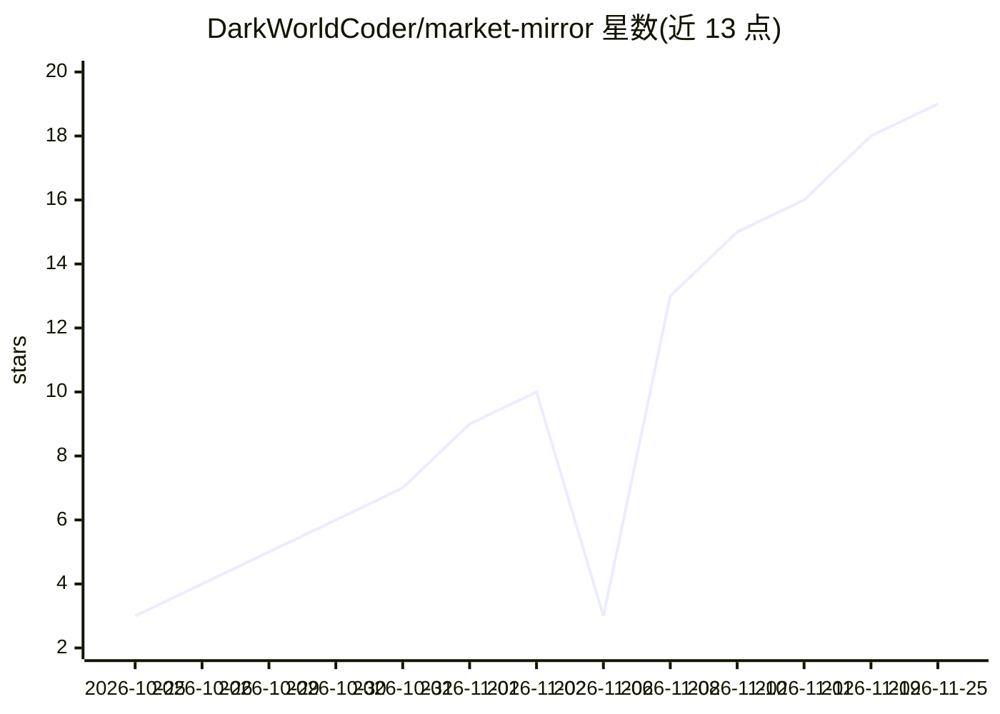

# DarkWorldCoder/market-mirror

⭐ 19 · Python · AGPL-3.0 · 推送 2026-11-23 · [GitHub](https://github.com/DarkWorldCoder/market-mirror) · [官网](https://darkworldcoder.github.io/market-mirror/) · 个人维护 · 中文 README

**自托管的 AI 营销模拟器：用模拟买家预演广告、定价与销售话术**

面向创始人、营销人员、销售与开发者团队的营销研究模拟工具：生成有背景、预算与信任顾虑的 LLM 买家角色，让其在模拟社交信息流（Facebook/Instagram/Reddit/TikTok/LinkedIn/X）、收件箱与销售对话中对广告、标题、定价、邮件和 pitch 做出反应，输出 go/iterate/no-go 建议与离线 HTML 仪表盘。支持 Claude Code、Codex、Gemini CLI、Cursor 等 MCP 客户端调用，可换模型提供商并比对结果差异；自托管，仅模型调用外发。买家回答由 AI 生成，不具真实人群代表性，需用真实小实验验证。

## 筛选速览

| 维度 | 判定 | 备注 |
|---|---|---|
| AI 角色 | `ai-native` | 本体是模型或模型工具 |
| 许可风险 | `viral` | AGPL-3.0 |
| 部署形态 | `self-host` | docker 或自建部署 |
| 模型依赖 | local-ok | 支持本地模型 |
| 硬件要求 | — | 无带数字的原话,不猜 |
| 安装摩擦 | `low` | 无编译、无系统依赖或容器化 |
| 成熟度 | — | 结构信号不足 |

## 能力要点

- LLM 生成带背景与决策卡的模拟买家，跨运行内可记忆先前反应
- 模拟六大社交平台信息流、收件箱、定价对比与销售 pitch 测试
- 输出 go/iterate/no-go 建议、买家反馈与可离线分享的 HTML 报告
- MCP server 形态接入 Claude Code/Codex/Gemini CLI/Cursor，支持多提供商比对

## 适用场景

- 上线前比较不同广告、标题与定价方案的反应
- 练习销售 pitch 并发现潜在客户顾虑
- 规划下一步真实客户小实验并导入真实数据对比模拟结果

## 场景标签

`多智能体` · 领域:Agent 开发

## 证据(README 行号)

> L9: **Open source and built for AI agents.** Interviewed LLM buyer personas scroll simulated ad feeds, argue in an OASIS
> L48: MarketMirror gives you a practice audience for your next marketing decision. Describe your product and the people y
> L54: **The buyers are simulated.** Their responses are generated by AI, so use them to develop and compare ideas. Confir

## 星数曲线

2026-10-25 3 → 2026-11-25 19（+16）

---
*卡片 v1 · prompt 1.4 · 生成 2026-11-18 · 置信度 mid · 依据 README sha `b77a9570ea64` · [字段定义](../../DATASET.md)*
