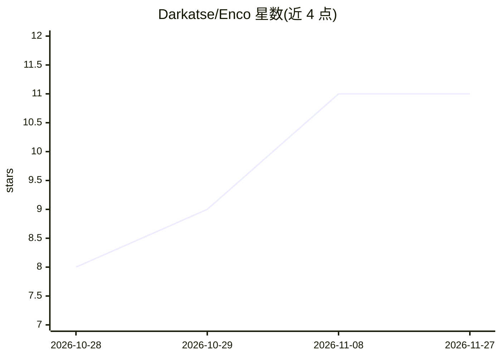

# Darkatse/Enco

⭐ 11 · Rust · Apache-2.0 · 推送 2026-11-11 · [GitHub](https://github.com/Darkatse/Enco) · [官网](https://enco.sh/) · 个人维护 · 中文 README

**个人专属、自维护的常驻 AI 代理（Rust 内核 + WASM 插件）**

在用户自己的机器上以全权限运行的个人代理助手：内核负责记录事实、调度与校验，所有能力（模型接入、聊天渠道、请求组装、搜索工具）皆为可热替换的 WebAssembly 插件。代理可读写自身插件并在故障时自动回滚，全部请求写入 append-only SQLite 日志以支持崩溃恢复与跨机迁移；长期记忆存于 SQLite 并经 TriviumDB 向量+关键词索引召回。支持 Telegram/Discord/QQ OneBot 渠道，多设备漫游（P4/P5）仍在路线图。macOS/Linux 提供 curl 一键脚本、Docker 镜像与源码构建三种方式。

## 筛选速览

| 维度 | 判定 | 备注 |
|---|---|---|
| AI 角色 | `ai-native` | 本体是模型或模型工具 |
| 许可风险 | `permissive` | Apache-2.0 |
| 部署形态 | `self-host` | docker 或自建部署 |
| 模型依赖 | — | README 未给出锁定关系 |
| 硬件要求 | — | 无带数字的原话,不猜 |
| 安装摩擦 | `low` | 无编译、无系统依赖或容器化 |
| 成熟度 | `idea` | |

## 能力要点

- 能力皆为 WASM 插件，运行中可改写、校验并自动回滚
- append-only SQLite 日志支撑崩溃恢复与跨机迁移
- 私有长期记忆：SQLite + TriviumDB（中英/中文调优的向量+关键词检索）
- 多模型 provider 与 Telegram/Discord/QQ 渠道均为独立插件

## 适用场景

- 在自己服务器上运行一个长期在线、可自我修复的个人助理
- 通过 Telegram/Discord/QQ 与代理对话并处理多模态消息
- 让代理按自己的需求改写或编写新插件扩展能力

## 场景标签

`AI 助手` · 领域:对话与助手

## 证据(README 行号)

> L3: Enco is a personal agent assistant that runs on your own machines. Built on a Rust kernel and WebAssembly plugins, a
> L28: Model providers (OpenAI-Compatible, OpenAI Responses, Anthropic Messages, Gemini, DeepSeek), relevance decisions (T
> L42: Every model request and tool call is written to an append-only log before it runs, so the model only ever sees reco

## 星数曲线

2026-10-28 8 → 2026-11-27 11（+3）

---
*卡片 v1 · prompt 1.4 · 生成 2026-11-19 · 置信度 high · 依据 README sha `4f8248a4e61c` · [字段定义](../../DATASET.md)*
