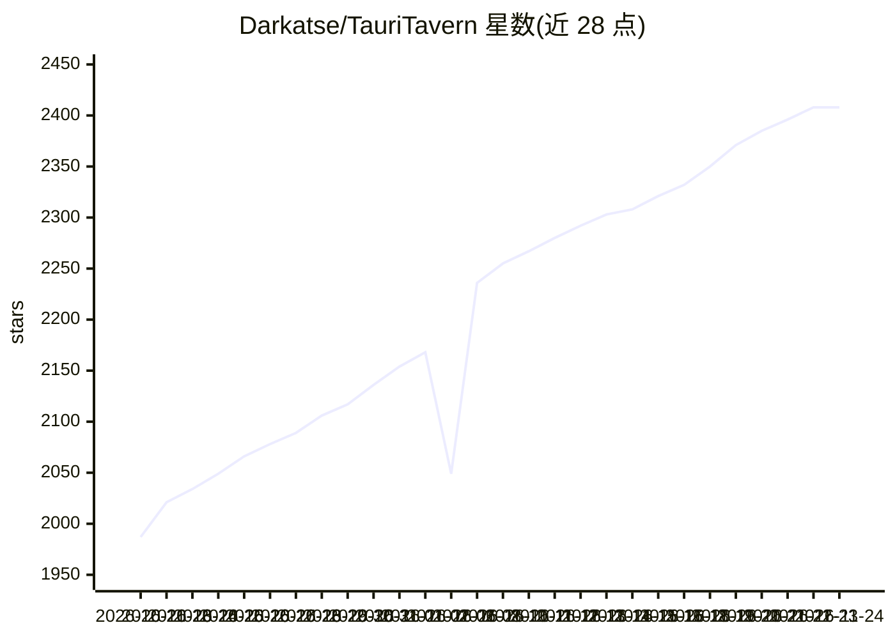

# Darkatse/TauriTavern

⭐ 2,408 · JavaScript · AGPL-3.0 · 推送 2026-11-22 · [GitHub](https://github.com/Darkatse/TauriTavern) · [官网](https://tauritavern.github.io) · 组织维护 · 中文 README

**SillyTavern 的 Tauri/Rust 原生客户端，桌面与移动开箱即用**

将 SillyTavern 移植为原生应用：前端完整保留上游体验（同步 1.19.0），后端从 Node.js 重构为 Rust（Tauri v2），用户无需安装 Node.js 或使用命令行。角色卡、聊天记录、预设、世界书与前端扩展全部兼容，提供数据迁移脚本。支持 Windows/macOS/Linux/Android/iOS 及鸿蒙 Beta，内置多设备同步、原生 Git 的扩展管理、Agent 框架（工具调用、子代理）。为独立维护项目，非 SillyTavern 官方客户端，AGPL-3.0 许可。

## 筛选速览

| 维度 | 判定 | 备注 |
|---|---|---|
| AI 角色 | `ai-native` | 本体是模型或模型工具 |
| 许可风险 | `viral` | AGPL-3.0 |
| 部署形态 | `library` | 以包/库形式分发 |
| 模型依赖 | — | README 未给出锁定关系 |
| 硬件要求 | — | 无带数字的原话,不猜 |
| 安装摩擦 | `low` | 无编译、无系统依赖或容器化 |
| 成熟度 | — | 结构信号不足 |

## 能力要点

- 后端由 Node.js 重构为 Rust（Tauri v2），无需安装 Node.js 即可运行
- 全平台分发：Windows/macOS/Linux 桌面 + Android/iOS/鸿蒙 Beta 移动端
- 与 SillyTavern 数据格式与目录布局完全兼容，附一键迁移
- 内置多设备同步（局域网加密配对或 TT-Sync v2 远端）

## 适用场景

- 在桌面或手机上运行 SillyTavern 类角色扮演聊天前端
- 从原版 SillyTavern 迁移角色卡与聊天记录继续使用
- 多设备间同步聊天数据

## 场景标签

`聊天机器人` · 领域:对话与助手

## 证据(README 行号)

> L5: **SillyTavern 的原生应用 —— 桌面与移动，开箱即用**
> L134: TauriTavern 把 SillyTavern 移植为真正的原生应用：前端完整保留上游体验（已同步 1.19.0），后端从 Node.js 重构为 Rust（Tauri v2）。
> L146: - 🤖 **Agent 框架**：工具调用、Skills、子代理与运行时间线，持续演进中

## 星数曲线

2026-10-21 1,987 → 2026-11-24 2,408（+421）

---
*卡片 v1 · prompt 1.4 · 生成 2026-11-23 · 置信度 mid · 依据 README sha `c0dba90346b1` · [字段定义](../../DATASET.md)*
