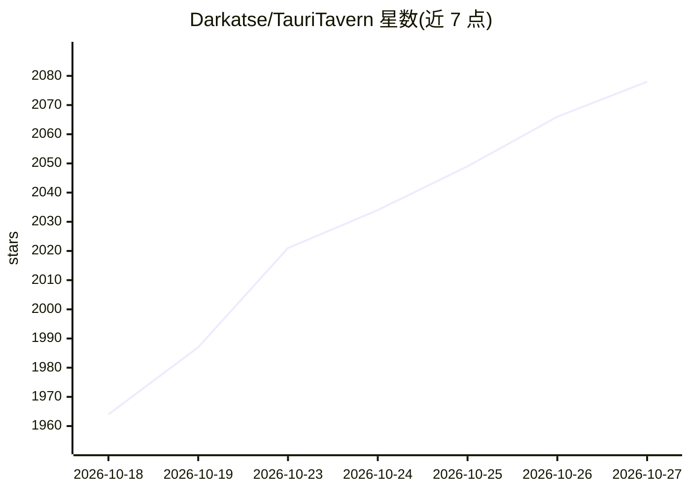

# Darkatse/TauriTavern

⭐ 2,078 · JavaScript · AGPL-3.0 · 推送 2026-10-26 · [GitHub](https://github.com/Darkatse/TauriTavern) · [官网](https://tauritavern.github.io) · 组织维护 · 中文 README

**SillyTavern 的 Tauri/Rust 原生桌面与移动客户端**

把 SillyTavern 前端（同步上游 1.18.0）移植为原生应用，后端由 Node.js 重构为 Rust（Tauri v2），覆盖 Windows、macOS、Linux、Android 与 iOS。用户无需安装 Node.js 与命令行，安装即用；角色卡、聊天记录、预设、世界书与前端扩展数据格式兼容，提供数据导出/导入迁移。内置原生 Git 扩展管理、局域网/远端多设备同步、Agent 框架（工具调用、Skills、子代理）。AGPL-3.0 开源，独立维护，非 SillyTavern 官方客户端。

## 筛选速览

| 维度 | 判定 | 备注 |
|---|---|---|
| AI 角色 | `ai-native` | 本体是模型或模型工具 |
| 许可风险 | `viral` | AGPL-3.0 |
| 部署形态 | `library` | 以包/库形式分发 |
| 模型依赖 | — | README 未给出锁定关系 |
| 硬件要求 | — | 无带数字的原话,不猜 |
| 安装摩擦 | `low` | 无编译、无系统依赖或容器化 |
| 成熟度 | `idea` | |

## 能力要点

- 全平台覆盖：Windows/macOS/Linux/Android/iOS 同一份体验
- 后端 Rust 重构，无需 Node.js 与命令行，数据格式与上游兼容
- 内置多设备同步（局域网加密配对或 TT-Sync v2）与 Agent 框架
- 一键迁移：上游数据导出脚本 + 应用内导入

## 适用场景

- 在桌面或手机上直接使用 SillyTavern 而不配置 Node.js 环境
- 把现有 SillyTavern 数据平滑迁移到原生应用
- 多设备间同步角色卡与聊天记录

## 场景标签

`聊天机器人` · 领域:对话与助手

## 证据(README 行号)

> L131: TauriTavern 把 SillyTavern 移植为真正的原生应用：前端完整保留上游体验（已同步 1.18.0），后端从 Node.js 重构为 Rust（Tauri v2）。
> L133: 不需要安装 Node.js，不需要命令行，安装即用。你的角色卡、聊天记录、预设、世界书与前端扩展，全部兼容。

## 星数曲线

2026-10-18 1,964 → 2026-10-27 2,078（+114）

---
*卡片 v1 · prompt 1.4 · 生成 2026-10-21 · 置信度 mid · 依据 README sha `b8dbff628c67` · [字段定义](../../DATASET.md)*
