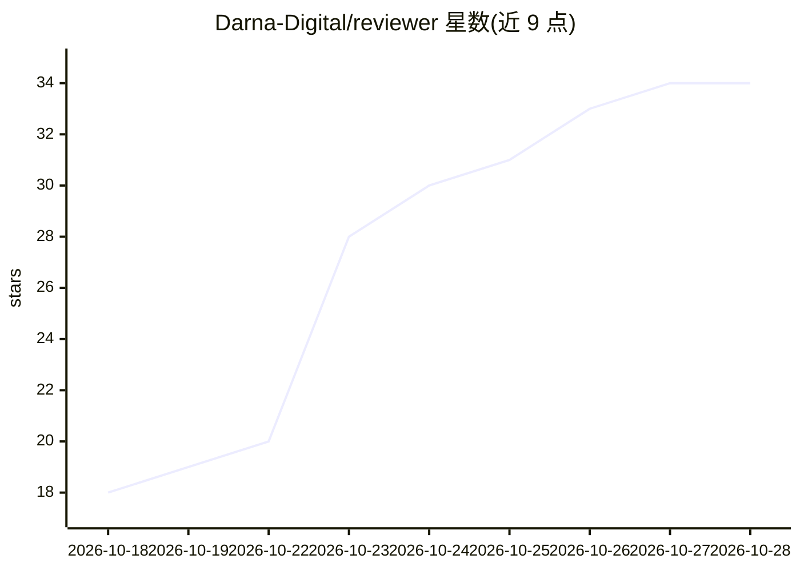

# Darna-Digital/reviewer

⭐ 35 · TypeScript · MIT · 推送 2026-10-28 · [GitHub](https://github.com/Darna-Digital/reviewer) · [官网](https://reviewer.sh) · 组织维护

**macOS 原生应用：查看 diff 并评审 AI 生成的代码**

面向 macOS 26+ / Apple silicon 的原生 SwiftUI/AppKit 应用，内置 React 视图与本地 API 服务器，提供并排或上下布局的 diff 查看器、行内评论、Git 分支与历史浏览、按变更生成提交信息、LSP 符号跳转（TypeScript/Swift/Ruby/PHP）与内置终端。AI 相关功能：在同一界面使用 Claude Code 与 Codex 等 agent 对话，并可通过 resolve-reviewer-comments 技能把评论分派给任意编码 agent 处理。以 dmg 安装包分发，签名并公证。

## 筛选速览

| 维度 | 判定 | 备注 |
|---|---|---|
| AI 角色 | `ai-enhanced` | 去掉 AI 部分产品仍成立 |
| 许可风险 | `permissive` | MIT |
| 部署形态 | `desktop` | 安装包/桌面程序 |
| 模型依赖 | locked-api |  |
| 硬件要求 | — | 无带数字的原话,不猜 |
| 安装摩擦 | `medium` | 含编译或系统依赖之一 |
| 成熟度 | — | 结构信号不足 |

## 能力要点

- 并排/上下布局的 diff 查看器与行内评论
- 同一界面接入 Claude Code、Codex 等 agent，评论可分派给 agent 修复
- LSP 集成（TypeScript/Swift/Ruby/PHP），符号跳转与全库用法查找
- 本地服务一键启动与内置终端

## 适用场景

- 评审 AI 生成的代码变更与 diff
- 把代码评论交给编码 agent 逐条修复
- 在原生 Mac 应用里完成 Git 分支、历史与提交管理

## 场景标签

`代码审查` · 领域:编码与开发

## 证据(README 行号)

> L5: **Understand AI-generated code.**
> L8: Reviewer is a delightful, smooth macOS app built precisely for that.
> L41: ### Work with Claude Code and Codex from the same interface

## 星数曲线

2026-10-18 18 → 2026-10-28 34（+16）

---
*卡片 v1 · prompt 1.4 · 生成 2026-10-25 · 置信度 mid · 依据 README sha `a64781f21094` · [字段定义](../../DATASET.md)*
