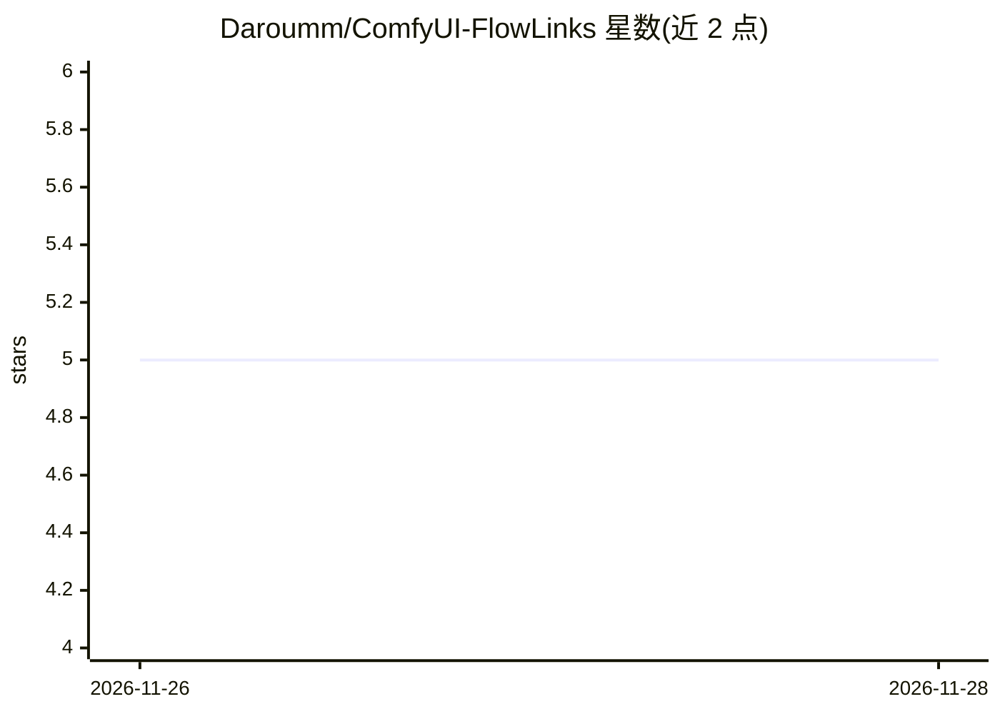

# Daroumm/ComfyUI-FlowLinks

⭐ 5 · JavaScript · MIT · 推送 2026-11-25 · [GitHub](https://github.com/Daroumm/ComfyUI-FlowLinks) · 个人维护 · 中文 README

**为 ComfyUI 添加水管流水连线与节点荧光的前端扩展**

以单个纯 JavaScript 前端扩展（web/flow_links.js）运行的 ComfyUI 界面插件：将工作流连线渲染为半透明水管，水流速度跟随前端 progress 事件报告的实际生成速度，连线按运行/完成/空闲/失败状态变化，并为每种节点类型分配独立荧光色。通过包装链接渲染器实现，不改图数据与提示词；提供 10 项设置的持久化面板。零 Python 依赖，安装后自动生效。

## 筛选速览

| 维度 | 判定 | 备注 |
|---|---|---|
| AI 角色 | `ai-enhanced` | 去掉 AI 部分产品仍成立 |
| 许可风险 | `permissive` | MIT |
| 部署形态 | `desktop` | 安装包/桌面程序 |
| 模型依赖 | — | README 未给出锁定关系 |
| 硬件要求 | — | 无带数字的原话,不猜 |
| 安装摩擦 | `low` | 无编译、无系统依赖或容器化 |
| 成熟度 | — | 结构信号不足 |

## 能力要点

- 连线动画速度跟随实时 steps/s（EMA 平滑）
- 按节点类型哈希分配互不冲突的荧光色，执行节点脉冲
- 零依赖：无 Python 节点、无模型、无 pip 安装
- 仅改变渲染层，不触碰图数据、提示词或生成图像

## 适用场景

- 在 ComfyUI 中可视化查看哪些连线正在传输数据
- 通过动画状态快速发现执行失败的节点
- 大型工作流编排时按颜色区分节点类型

## 场景标签

 · 领域:AI 绘图工具/UI 增强

## 证据(README 行号)

> L11: Animated **water-pipe workflow links** and **per-type neon node glow** for ComfyUI.
> L35: - **Zero-dependency frontend extension** — pure JavaScript, no Python nodes,
> L111: Because the takeover happens at the link-renderer level, **all** node types

## 星数曲线

2026-11-26 5 → 2026-11-28 5（+0）

---
*卡片 v1 · prompt 1.4 · 生成 2026-11-26 · 置信度 mid · 依据 README sha `f6d87be6ca76` · [字段定义](../../DATASET.md)*
