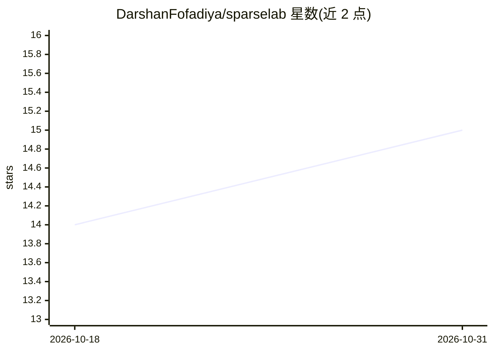

# DarshanFofadiya/sparselab

⭐ 15 · Python · MIT · 推送 2026-05-19 · [GitHub](https://github.com/DarshanFofadiya/sparselab) · 个人维护

**面向 PyTorch 的真稀疏动态训练库，CPU 原生、Apple Silicon 优先**

SparseLab 是一个 PyTorch 库，用于在消费级 CPU 上从头训练真稀疏神经网络：采用 Padded-CSR 真稀疏存储与稀疏核（SpMM/dW/transpose），非稠密掩码或训练后剪枝。提供可插拔 DST 路由器接口与 drop-in 的 SparseLinear 层；v0.2 加入手写 NEON 与 AVX2 内核，覆盖 macOS arm64 与 Linux x86_64/aarch64。面向 DST 研究者、无 GPU 的 PyTorch 用户与关注底层 CPU 性能的贡献者。README 报告小模型上每步仍慢于稠密 GPU，CPU 集群数据并行在路线图中尚未交付。

## 筛选速览

| 维度 | 判定 | 备注 |
|---|---|---|
| AI 角色 | `ai-ecosystem` | LLM/agent 周边工具 |
| 许可风险 | `permissive` | MIT |
| 部署形态 | `library` | 以包/库形式分发 |
| 模型依赖 | — | README 未给出锁定关系 |
| 硬件要求 | — | 无带数字的原话,不猜 |
| 安装摩擦 | `medium` | 含编译或系统依赖之一 |
| 成熟度 | — | 结构信号不足 |

## 能力要点

- 真稀疏存储（Padded-CSR）与训练时稀疏核，非掩码模拟
- 手写 NEON（Apple Silicon/aarch64）与 AVX2（x86_64）dW 内核
- 可插拔 DST 路由器接口与 drop-in SparseLinear
- 442 个测试（含 autograd gradcheck），预编译 wheel 覆盖 Python 3.11–3.13

## 适用场景

- 无 GPU 条件下在笔记本 CPU 上做稀疏训练研究
- 用 SparseLinear 替换稠密层做从头稀疏训练实验
- 在 Apple Silicon / Linux x86_64 上复现稀疏 vs 稠密质量-内存对比

## 场景标签

`模型训练` · 领域:训练与推理

## 证据(README 行号)

> L14: SparseLab is a PyTorch library for training sparse neural networks
> L62: **For whom:** DST researchers. PyTorch users without GPU access.
> L77: |**SparseLab** (us)|**Real sparse (Padded-CSR)**|**From scratch, pluggable DST**|**CPU (NEON + AVX2 + OpenMP)**|**Y

## 星数曲线

2026-10-18 14 → 2026-10-31 15（+1）

---
*卡片 v1 · prompt 1.4 · 生成 2026-10-31 · 置信度 high · 依据 README sha `f747868e72ba` · [字段定义](../../DATASET.md)*
