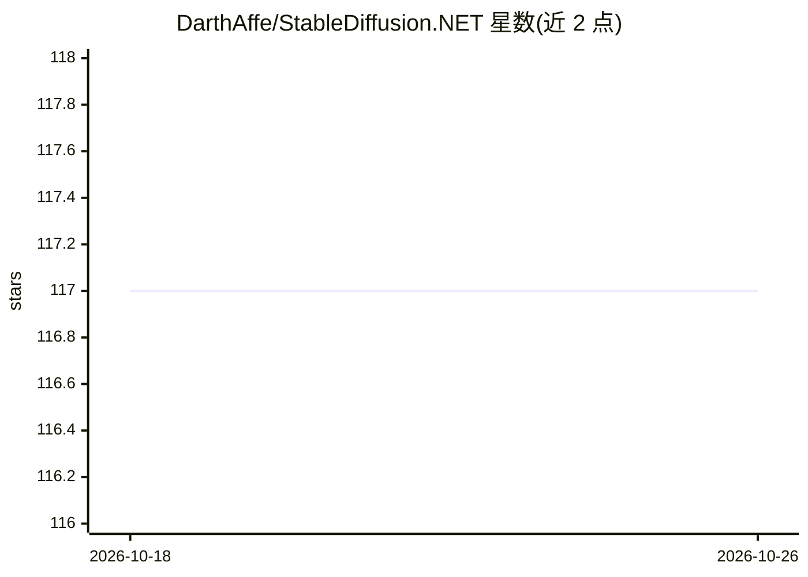

# DarthAffe/StableDiffusion.NET

⭐ 117 · C# · MIT · 推送 2026-06-11 · [GitHub](https://github.com/DarthAffe/StableDiffusion.NET) · 个人维护

**stable-diffusion.cpp 的 C#/.NET 封装库，供 .NET 应用生成图像**

对 leejet/stable-diffusion.cpp 的 C# 包装：通过 Nuget 主包加后端包的形式，把 Stable Diffusion 文生图/图生图能力接入 .NET 应用。提供初始化事件（日志与进度回调）的模型加载与推理 API；若检测到 GPU 支持则优先使用 GPU 而非 CPU；可通过静态 Backends 类自定义加载的原生库与后端。生成结果可经 HPPH 扩展包（System.Drawing / SkiaSharp）进一步处理。面向 .NET 开发者。

## 筛选速览

| 维度 | 判定 | 备注 |
|---|---|---|
| AI 角色 | `ai-ecosystem` | LLM/agent 周边工具 |
| 许可风险 | `permissive` | MIT |
| 部署形态 | `None` |  |
| 模型依赖 | — | README 未给出锁定关系 |
| 硬件要求 | — | 无带数字的原话,不猜 |
| 安装摩擦 | `low` | 无编译、无系统依赖或容器化 |
| 成熟度 | — | 结构信号不足 |

## 能力要点

- 封装 stable-diffusion.cpp 的模型加载与推理 API
- GPU 可用时优先于 CPU，后端按需选择
- HPPH.System.Drawing / HPPH.SkiaSharp 扩展处理生成图像
- Nuget 主包 + 后端包的模块化分发，语义化版本

## 适用场景

- 在 C#/.NET 应用中集成 Stable Diffusion 文生图/图生图
- 选择 CPU 或 GPU 后端运行 Stable Diffusion 推理
- 在 .NET 环境下对生成图像做后续绘制处理

## 场景标签

`图像生成` · 领域:内容生成

## 证据(README 行号)

> L7: Based on https://github.com/leejet/stable-diffusion.cpp
> L11: Install the StableDiffusion.NET-Nuget and at least one of the Backend-Packages.

## 星数曲线

2026-10-18 117 → 2026-10-26 117（+0）

---
*卡片 v1 · prompt 1.4 · 生成 2026-10-23 · 置信度 mid · 依据 README sha `c50534150c8e` · [字段定义](../../DATASET.md)*
