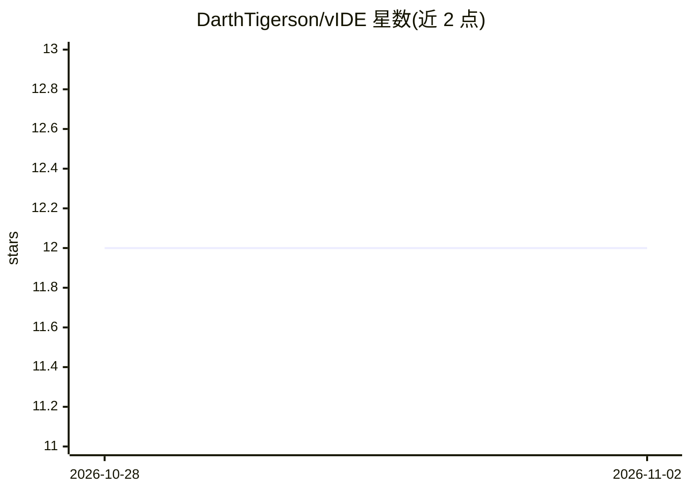

# DarthTigerson/vIDE

⭐ 12 · TypeScript · MIT · 推送 2026-10-25 · [GitHub](https://github.com/DarthTigerson/vIDE) · 个人维护

**面向终端 AI 编码代理的 Electron 桌面 IDE，支持本地模型**

Electron 桌面应用：将 Monaco 编辑器、真实终端与 git 工具（多仓库面板、log/graph、diff、提交推送）包裹在一个或多个并行运行的 AI 编码代理周围。内置 Claude Code 终端代理面板、经 llama.cpp 运行本地模型的 Llama 面板、对接任意 OpenAI 兼容端点（Ollama、LM Studio 等）的 Bridge 面板；To Do、Notes、Browser、Scripts 四个面板以 MCP server 暴露给代理直接驱动。限制：仅支持 macOS（Apple Silicon）与基于 Debian/Ubuntu 的 x86_64 Linux，Claude Code CLI 需另行安装；附带 Docker 面板、手机配对显示等辅助功能。

## 筛选速览

| 维度 | 判定 | 备注 |
|---|---|---|
| AI 角色 | `ai-enhanced` | 去掉 AI 部分产品仍成立 |
| 许可风险 | `permissive` | MIT |
| 部署形态 | `desktop` | 安装包/桌面程序 |
| 模型依赖 | local-ok | 支持本地模型 |
| 硬件要求 | — | 无带数字的原话,不猜 |
| 安装摩擦 | `low` | 无编译、无系统依赖或容器化 |
| 成熟度 | — | 结构信号不足 |

## 能力要点

- Claude Code 以一等终端代理运行，支持多并发会话并在重启后恢复
- Llama 面板经 llama.cpp 启动 llama-server 管理本地模型，应用内自动拉起
- Bridge 面板对接任意 OpenAI 兼容本地端点（Ollama、LM Studio 等）
- 四个内置面板作为 MCP server 暴露，代理可直接操作

## 适用场景

- 在同一窗口内驱动 AI 编码代理并审查、编辑其改动
- 在本地机器上同时运行编辑器与本地 LLM 并监控内存占用
- 通过 MCP 让代理直接操作待办、笔记、浏览器与脚本

## 场景标签

`编码 Agent` · 领域:编码与开发

## 证据(README 行号)

> L3: An agentic IDE — an Electron desktop app built around terminal AI
> L21: vIDE wraps a Monaco-based code editor, a real terminal, and git tooling
> L40: - **Claude panel** — run Claude Code as a first-class terminal agent, with

## 星数曲线

2026-10-28 12 → 2026-11-02 12（+0）

---
*卡片 v1 · prompt 1.4 · 生成 2026-11-01 · 置信度 low · 依据 README sha `0734d3564cbd` · [字段定义](../../DATASET.md)*
