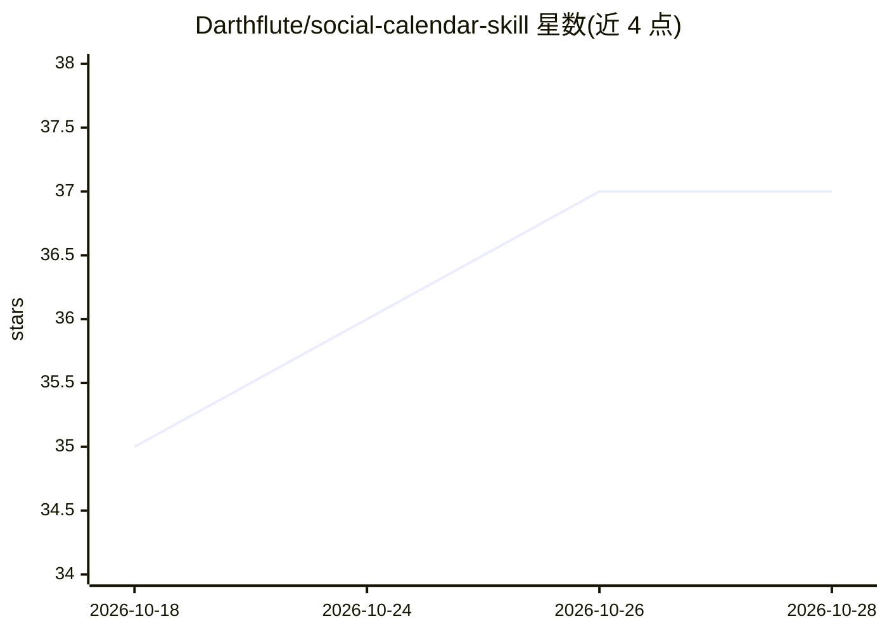

# Darthflute/social-calendar-skill

⭐ 37 · Python · 推送 2026-04-24 · [GitHub](https://github.com/Darthflute/social-calendar-skill) · 个人维护

**给营销人员的 Claude Code 社媒内容技能：一键生成月度日历与审计报告**

以 SKILL.md 形式安装到 Claude Code 的社交媒体内容生产技能，提供四种模式：月度内容日历（覆盖 12 个平台、输出带格式的 xlsx）、品牌社媒渠道评分审计（Markdown 报告）、竞品对比与内容缺口分析，以及三者串行的完整套件。流程含品牌研究、关键词提取、Reddit/X/YouTube 社区调研（依赖可选的 /last30days 技能，否则回退 WebSearch）和唯一审批门 narrative brief。需 Claude Code 与 Python 3.8+、openpyxl。

## 筛选速览

| 维度 | 判定 | 备注 |
|---|---|---|
| AI 角色 | `ai-ecosystem` | LLM/agent 周边工具 |
| 许可风险 | `none` | — |
| 部署形态 | `library` | 以包/库形式分发 |
| 模型依赖 | locked-api |  |
| 硬件要求 | — | 无带数字的原话,不猜 |
| 安装摩擦 | `low` | 无编译、无系统依赖或容器化 |
| 成熟度 | — | 结构信号不足 |

## 能力要点

- 四种模式：日历/审计/竞品分析/完整套件，单命令产出
- 覆盖 LinkedIn、X、Instagram、TikTok、YouTube 等 12 个平台的原生内容
- 输出带 Overview/周表/视频表的 xlsx 日历与 Markdown 审计/竞品报告
- 调研依赖可选 /last30days 技能，缺省回退 WebSearch

## 适用场景

- 让 Claude 为我的品牌生成整月多平台社媒内容日历
- 审计我现有社媒渠道并得到评分与优先行动清单
- 分析竞品社媒表现，找没人占位的内容角度

## 场景标签

`AI 写作` · 领域:内容生成

## 证据(README 行号)

> L3: > Research, audit, compete, and publish. A complete social media intelligence and content production system for any 
> L7: This Claude Code skill is a three-mode social media system:
> L107: |**Claude Code**|Any plan — claude.ai/code|

## 星数曲线

2026-10-18 35 → 2026-10-28 37（+2）

---
*卡片 v1 · prompt 1.4 · 生成 2026-10-25 · 置信度 mid · 依据 README sha `320a75e998bd` · [字段定义](../../DATASET.md)*
