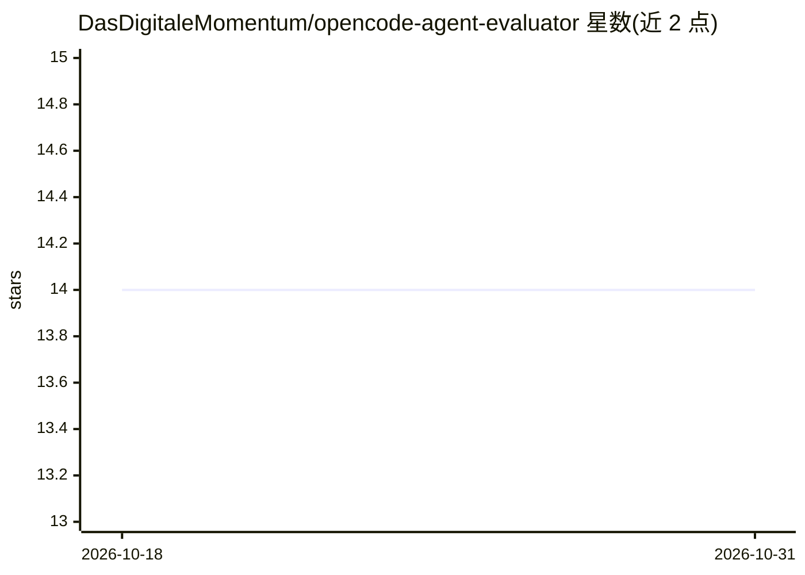

# DasDigitaleMomentum/opencode-agent-evaluator

⭐ 14 · TypeScript · MIT · 推送 2026-10-16 · [GitHub](https://github.com/DasDigitaleMomentum/opencode-agent-evaluator) · [官网](https://www.das-digitale-momentum.de/en/open-source/#opencode-agent-evaluator) · 组织维护

**在 OpenCode 上评测 AI 编程 agent 并追踪 token 去向的 CLI**

TypeScript 编写的 CLI 工具，连接 OpenCode TUI 的 web 服务器（端口 4096），运行基准测试并记录每次会话的输入/输出/推理/缓存 token。支持会话层级标注（LEAD/SUB）、工具调用 token 估算、YAML 结构化输出，以及用分析脚本聚合多次运行结果。内置 Chimera 与 Phoenix 两个由 Gemini 生成的后端代码基准项目（含分阶段任务与 testbed 管理）。需 Node.js 18+ 和运行中的 OpenCode TUI 实例；不可用 opencode serve（响应格式不兼容）。注意：非 OpenCode 官方出品。

## 筛选速览

| 维度 | 判定 | 备注 |
|---|---|---|
| AI 角色 | `ai-ecosystem` | LLM/agent 周边工具 |
| 许可风险 | `permissive` | MIT |
| 部署形态 | `library` | 以包/库形式分发 |
| 模型依赖 | — | README 未给出锁定关系 |
| 硬件要求 | — | 无带数字的原话,不猜 |
| 安装摩擦 | `low` | 无编译、无系统依赖或容器化 |
| 成熟度 | — | 结构信号不足 |

## 能力要点

- 按会话追踪输入/输出/推理/缓存四类 token
- 会话标注 LEAD/SUB 与工具调用 token 估算
- YAML 指标输出与分析脚本聚合多次基准结果
- 内置 Chimera/Phoenix 两个分阶段后端基准项目与 testbed 脚本

## 适用场景

- 对比不同 agent 配置和模型的 token 消耗与耗时
- 分析子代理生成与工具调用对上下文的影响
- 在统一基线上复跑基准并聚合历史结果

## 场景标签

`模型评测` · 领域:评测与运维

## 证据(README 行号)

> L3: A CLI tool to benchmark AI coding agents running on OpenCode. Compare different agent configurations and track where
> L9: - **Token tracking**: Input, output, reasoning, and cache tokens per session
> L40: > **Important:** The evaluator connects to OpenCode's TUI web server (port 4096). Do NOT use `opencode serve` – it 

## 星数曲线

2026-10-18 14 → 2026-10-31 14（+0）

---
*卡片 v1 · prompt 1.4 · 生成 2026-10-31 · 置信度 high · 依据 README sha `6aeb313da13a` · [字段定义](../../DATASET.md)*
