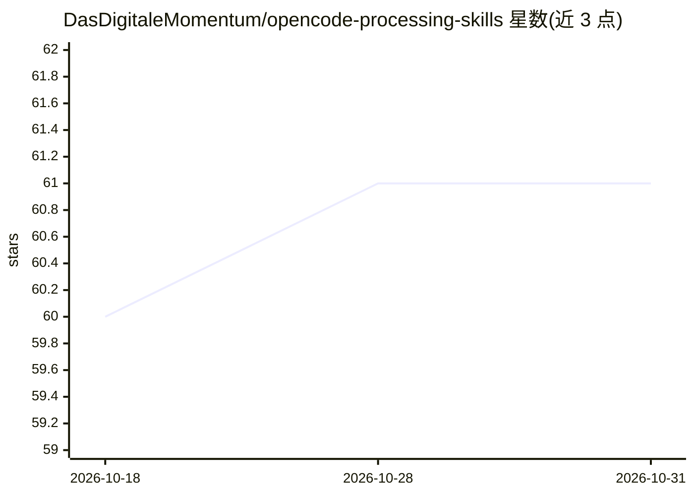

# DasDigitaleMomentum/opencode-processing-skills

⭐ 61 · JavaScript · MIT · 推送 2026-10-16 · [GitHub](https://github.com/DasDigitaleMomentum/opencode-processing-skills) · [官网](https://www.das-digitale-momentum.de/en/open-source/#opencode-processing-skills) · 个人维护

**面向 OpenCode/Codex/Claude Code 的结构化 AI 辅助开发技能与模板集**

跨 OpenCode、Codex、Claude Code、Cursor 等多个 agent harness 分发的工作流技能、agent 定义与模板：一个安装器自动检测已装的 harness 并同步对应资产。内容覆盖代码库结构化文档、跨会话持久化规划（plans/、docs/ 文件化）、子 agent 门控实现（先蓝图后写码）、以及 checkpoint 机制——父子 agent 向 JSONL 日志写入 done/next 检查点，包含输入用量遥测与三词指令遵循 Canary，附带终端实时仪表盘。供希望在有限上下文窗口下做长周期、多会话 AI 辅助开发的开发者使用。模型供应商无关，可配置 OpenAI、Anthropic、DeepSeek 等。声明与 OpenCode 团队无隶属关系。

## 筛选速览

| 维度 | 判定 | 备注 |
|---|---|---|
| AI 角色 | `ai-ecosystem` | LLM/agent 周边工具 |
| 许可风险 | `permissive` | MIT |
| 部署形态 | `None` |  |
| 模型依赖 | — | README 未给出锁定关系 |
| 硬件要求 | — | 无带数字的原话,不猜 |
| 安装摩擦 | `low` | 无编译、无系统依赖或容器化 |
| 成熟度 | — | 结构信号不足 |

## 能力要点

- 单安装器自动检测并同步 OpenCode/Codex/Claude Code/Cursor/Hermes 的技能与适配器
- 文件化持久规划：plans/ 与 docs/ 作为接口，知识跨会话存活
- 门控实现：子 agent 先提交蓝图，主 agent 审批后再写代码
- checkpoint JSONL 日志与终端实时仪表盘，含输入用量遥测与三词 Canary 合规追踪

## 适用场景

- 在 OpenCode 或 Claude Code 中做多会话、跨天的长周期开发规划
- 限制上下文膨胀：用结构化文档与检索替代重复阅读已探索文件
- 在写码前通过蓝图审批捕获子 agent 的理解偏差
- 用终端仪表盘监控多 agent 会话进度与输入余量

## 场景标签

`多智能体` `编码 Agent` · 领域:Agent 开发

## 证据(README 行号)

> L3: Agents, skills, and templates for **structured AI-assisted development** across OpenCode, Codex, Claude Code, and ot
> L9: One installer synchronizes the compatible workflow and checkpoint assets for each detected harness:
> L48: This repo solves that. Across the supported harnesses, it provides:

## 星数曲线

2026-10-18 60 → 2026-10-31 61（+1）

---
*卡片 v1 · prompt 1.4 · 生成 2026-10-24 · 置信度 high · 依据 README sha `609948be91ba` · [字段定义](../../DATASET.md)*
