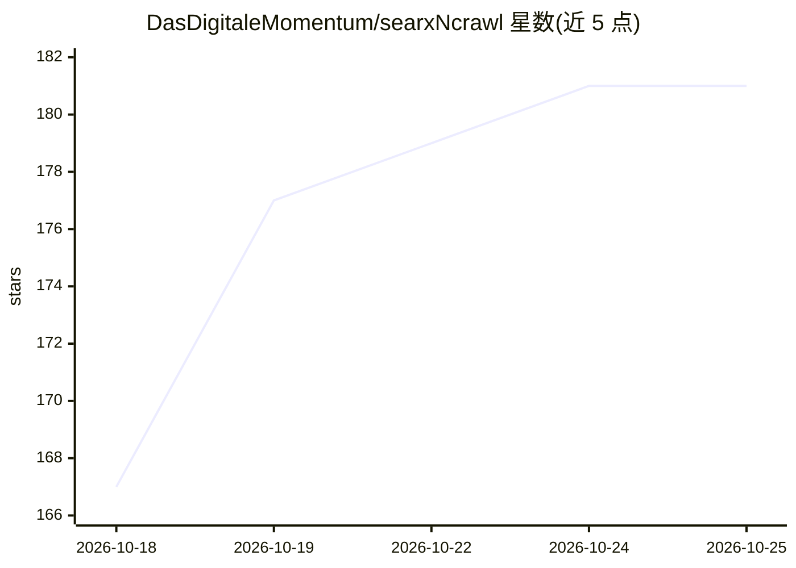

# DasDigitaleMomentum/searxNcrawl

⭐ 181 · Python · MIT · 推送 2026-10-24 · [GitHub](https://github.com/DasDigitaleMomentum/searxNcrawl) · [官网](https://www.searxncrawl.io) · 组织维护

**给 AI agent 的自托管 MCP 搜索与爬取服务器**

开源 MCP 服务器与 CLI 工具集，基于 Crawl4AI 为 AI agent 提供 Web 搜索与页面转 Markdown 爬取。搜索可并行查询自托管 SearXNG 和/或 You.com API 并合并去重结果；提供单页/整站爬取、登录后爬取（crawl-capture 会话捕获）、CLI 与 Python API。通过 uvx 运行，setup 命令可自动配置 Claude Code、Codex、Cursor、VS Code 等客户端；无需 API key（使用 SearXNG 时）。为 searxng-mcp 的后继项目，Firecrawl 兼容 API 在规划中。

## 筛选速览

| 维度 | 判定 | 备注 |
|---|---|---|
| AI 角色 | `ai-ecosystem` | LLM/agent 周边工具 |
| 许可风险 | `permissive` | MIT |
| 部署形态 | `self-host` | docker 或自建部署 |
| 模型依赖 | — | README 未给出锁定关系 |
| 硬件要求 | — | 无带数字的原话,不猜 |
| 安装摩擦 | `low` | 无编译、无系统依赖或容器化 |
| 成熟度 | — | 结构信号不足 |

## 能力要点

- SearXNG 与 You.com 并行搜索、合并去重并标注来源
- Playwright Chromium 渲染页面后输出 Markdown/JSON，支持 JS 重页面
- crawl-capture 捕获登录会话后爬取登录后区域
- uvx searxncrawl setup 一键配置多种 MCP 客户端

## 适用场景

- 让我的编程 agent 具备自托管网络搜索能力
- 把文档站或页面爬成干净 Markdown 供 LLM 使用
- 不想依赖按次计费的托管搜索/爬取 API

## 场景标签

`网页抓取` · 领域:效率与自动化

## 证据(README 行号)

> L24: **searxNcrawl** is an open-source MCP server and CLI toolkit that gives AI agents web search and clean Markdown cra
> L117: |Tool|What it does|

## 星数曲线

2026-10-18 167 → 2026-10-25 181（+14）

---
*卡片 v1 · prompt 1.4 · 生成 2026-10-22 · 置信度 high · 依据 README sha `b81b414ed07f` · [字段定义](../../DATASET.md)*
