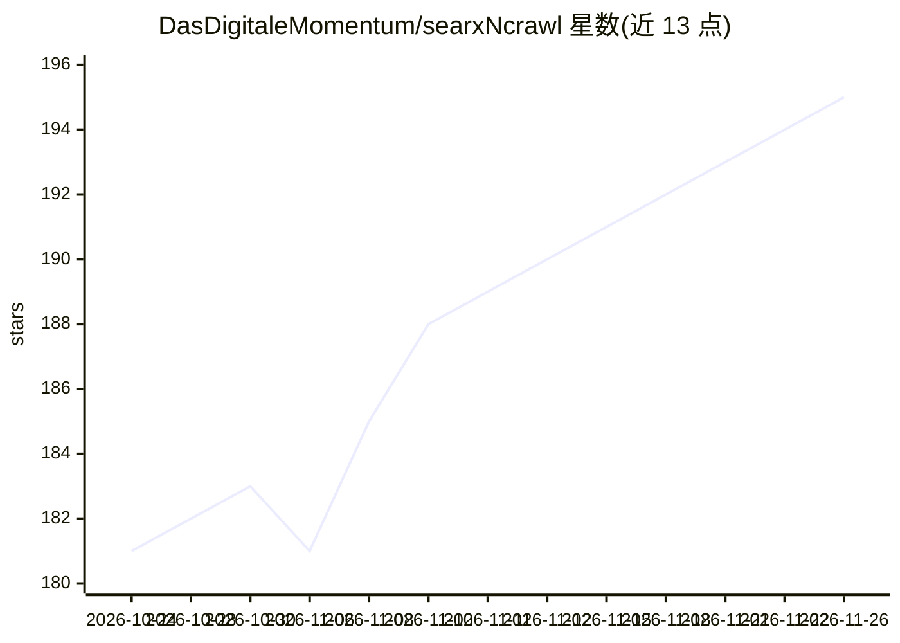

# DasDigitaleMomentum/searxNcrawl

⭐ 195 · Python · MIT · 推送 2026-11-25 · [GitHub](https://github.com/DasDigitaleMomentum/searxNcrawl) · [官网](https://www.searxncrawl.io) · 组织维护

**给 AI agent 提供自托管网页搜索与 Markdown 抓取的 MCP 服务器**

基于 Crawl4AI 构建的开源 MCP 服务器与 CLI 工具集，为 agent 提供三个工具：search（并行查询 SearXNG 与 You.com 并合并去重）、crawl（Chromium 渲染 URL 输出 Markdown/JSON）、crawl_site（限深抓取整站）。支持登录后会话抓取（storage_state）、STDIO 与 HTTP 两种传输、Python API。运行在自有硬件上，SearXNG 路径无需 API key；首次抓取需下载约 550MB 的 Playwright Chromium。search 功能需要自备 SearXNG 实例（开启 JSON 输出）或 You.com key。

## 筛选速览

| 维度 | 判定 | 备注 |
|---|---|---|
| AI 角色 | `ai-ecosystem` | LLM/agent 周边工具 |
| 许可风险 | `permissive` | MIT |
| 部署形态 | `self-host` | docker 或自建部署 |
| 模型依赖 | — | README 未给出锁定关系 |
| 硬件要求 | — | 无带数字的原话,不猜 |
| 安装摩擦 | `low` | 无编译、无系统依赖或容器化 |
| 成熟度 | — | 结构信号不足 |

## 能力要点

- 三个 MCP 工具：search/crawl/crawl_site，支持语言、时间范围、safe search 等过滤
- crawl-capture 捕获登录会话后抓取登录后页面
- uvx searxncrawl setup 自动检测 Claude Code、Cursor、VS Code 等客户端并写入配置
- STDIO/HTTP 双传输，HTTP 模式支持 Host/Origin 校验与 CORS 配置

## 适用场景

- 让本地 agent 具备网页搜索并把页面转成 Markdown 上下文
- 自托管替代按调用计费的托管搜索抓取 API
- 抓取需要登录的文档站或站点并保持干净输出

## 场景标签

`网页抓取` · 领域:效率与自动化

## 证据(README 行号)

> L23: **searxNcrawl** is an open-source MCP server and CLI toolkit that gives AI agents web search and clean Markdown cra
> L30:  STDIO and HTTP Plug into local MCP clients, or run an HTTP endpoint with opt-in Host/Origin checks and configurabl
> L129: Results return to the agent as the tool response. Search and crawling are also available as the `search` and `craw

## 星数曲线

2026-10-24 181 → 2026-11-26 195（+14）

---
*卡片 v1 · prompt 1.4 · 生成 2026-11-25 · 置信度 high · 依据 README sha `e5bfff9c9ea9` · [字段定义](../../DATASET.md)*
