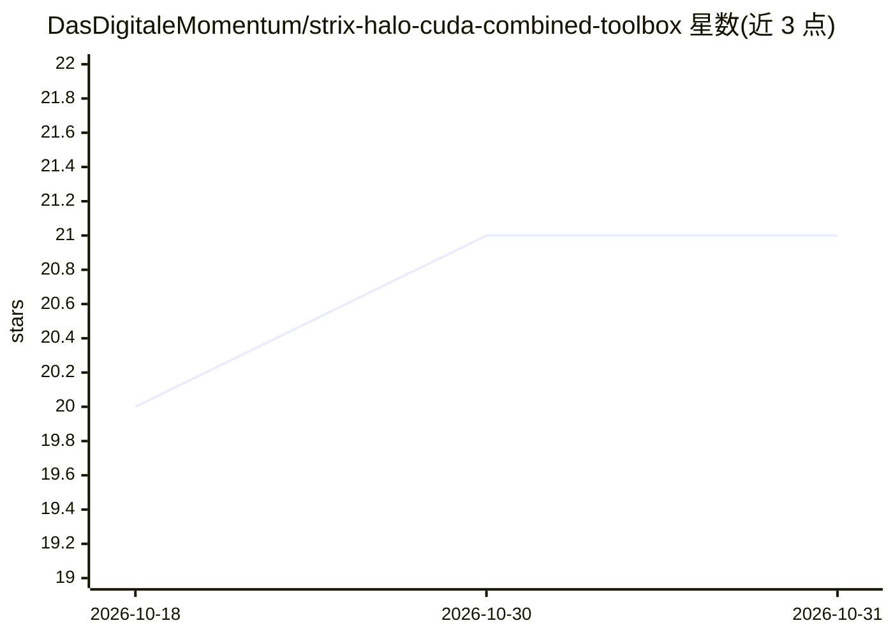

# DasDigitaleMomentum/strix-halo-cuda-combined-toolbox

⭐ 21 · Shell · MIT · 推送 2026-10-16 · [GitHub](https://github.com/DasDigitaleMomentum/strix-halo-cuda-combined-toolbox) · [官网](https://www.das-digitale-momentum.de/en/open-source/#strix-halo-cuda-combined-toolbox) · 个人维护

**在单容器中同时编译 ROCm 与 CUDA 后端运行 llama.cpp 的双 GPU 推理工具箱**

基于 distrobox/podman 的独立容器工具箱，将 llama.cpp 以 GGML_BACKEND_DL=ON 方式构建，使 AMD ROCm/HIP 与 NVIDIA CUDA 后端以独立 .so 插件形式共存于同一二进制，通过 --tensor-split 实现跨厂商双 GPU 推理。面向拥有 AMD Strix Halo APU 加 NVIDIA 独显（实测 Radeon 8060S + RTX 3060）的 Linux 用户。README 附带基准数据、已知限制（跨后端 -ot 不可靠、设备顺序不可配置、构建目标需按硬件修改）及 gguf-vram-estimator 脚本。MIT 许可。

## 筛选速览

| 维度 | 判定 | 备注 |
|---|---|---|
| AI 角色 | `ai-ecosystem` | LLM/agent 周边工具 |
| 许可风险 | `permissive` | MIT |
| 部署形态 | `self-host` | docker 或自建部署 |
| 模型依赖 | local-ok | 支持本地模型 |
| 硬件要求 | — | 无带数字的原话,不猜 |
| 安装摩擦 | `low` | 无编译、无系统依赖或容器化 |
| 成熟度 | — | 结构信号不足 |

## 能力要点

- 单构建内同时支持 ROCm0 与 CUDA0 设备，跨后端 --tensor-split 层切分
- GGML_BACKEND_DL=ON 将各后端编译为运行时加载的 .so 插件，避免符号冲突
- 提供 Qwen3.5 27B/122B 等模型的双 GPU 基准数据与推荐切分参数
- 附 gguf-vram-estimator.py 脚本估算模型显存需求

## 适用场景

- 在 Strix Halo APU + NVIDIA 独显主机上让两块 GPU 共同承担大模型推理
- 在隔离容器中构建和运行多后端 llama.cpp 而不污染宿主系统
- 为 12GB 级 NVIDIA 显卡分配合适的张量切分比例以避免 OOM

## 场景标签

`推理引擎` · 领域:训练与推理

## 证据(README 行号)

> L3: A standalone, distrobox-based container that runs llama.cpp with both AMD ROCm/HIP and NVIDIA CUDA backends compiled
> L15: llama.cpp is built with `GGML_BACKEND_DL=ON`, which compiles each backend (HIP, CUDA, CPU variants) as a separate `
> L21: - **Linux host** (tested on Ubuntu 25.10)

## 星数曲线

2026-10-18 20 → 2026-10-31 21（+1）

---
*卡片 v1 · prompt 1.4 · 生成 2026-10-28 · 置信度 mid · 依据 README sha `a0761938b8da` · [字段定义](../../DATASET.md)*
