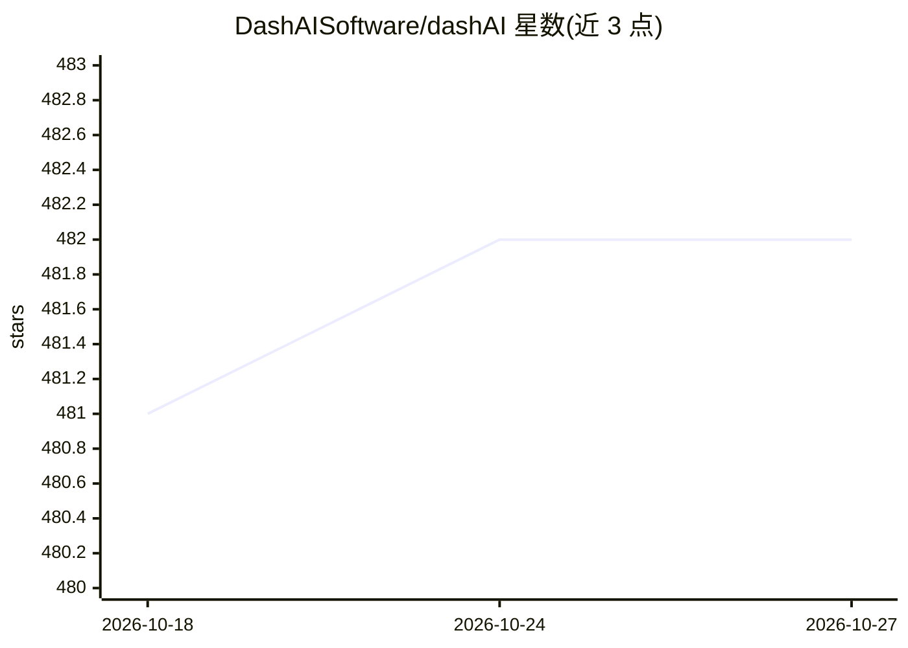

# DashAISoftware/dashAI

⭐ 482 · Python · MIT · 推送 2026-10-26 · [GitHub](https://github.com/DashAISoftware/dashAI) · [官网](http://dash-ai.com/) · 组织维护

**图形化 AI 模型训练、评估与部署工具箱**

dashAI 是一个带 Web 图形界面的 AI 工作台，通过浏览器（localhost:8000）操作模型的训练、评估与部署，覆盖 PyTorch 模型与 GGUF 格式 LLM（Llama、Mistral、Qwen 等，后者需另装 llama-cpp-python）。提供 Windows/macOS/Linux 桌面安装包（仅 CPU、自带 Python 3.12），也可经 pip/uv 安装，并附带 CPU 与 CUDA 两套 Dockerfile。桌面安装包要求 AVX2 指令集 CPU；GPU 加速（CUDA 12.8/ROCm 6.4）需手动重装 PyTorch。

## 筛选速览

| 维度 | 判定 | 备注 |
|---|---|---|
| AI 角色 | `ai-ecosystem` | LLM/agent 周边工具 |
| 许可风险 | `permissive` | MIT |
| 部署形态 | `desktop` | 安装包/桌面程序 |
| 模型依赖 | local-ok | 支持本地模型 |
| 硬件要求 | `cpu-ok` | |
| 安装摩擦 | `low` | 无编译、无系统依赖或容器化 |
| 成熟度 | — | 结构信号不足 |

## 能力要点

- Web 图形界面完成模型训练、评估与部署流程
- 支持 PyTorch 模型与 GGUF LLM（需可选安装 llama-cpp-python）
- 三平台桌面安装包（自带 Python、仅 CPU）与 CPU/CUDA Docker 镜像
- 提供 NVIDIA CUDA 12.8 与 AMD ROCm 6.4 加速安装路径

## 适用场景

- 在图形界面中训练和评估机器学习模型，无需写代码
- 在应用内运行 GGUF 格式的本地 LLM
- 用 Docker 容器部署 dashAI 服务

## 场景标签

`模型训练` `模型评测` `推理引擎` · 领域:评测与运维

## 证据(README 行号)

> L10: A graphical toolbox for training, evaluating and deploying state-of-the-art
> L231: Then open `http://localhost:8000/ <http://localhost:8000/>`_ in your browser to

## 星数曲线

2026-10-18 481 → 2026-10-27 482（+1）

---
*卡片 v1 · prompt 1.4 · 生成 2026-10-21 · 置信度 high · 依据 README sha `7340c3139d3e` · [字段定义](../../DATASET.md)*
