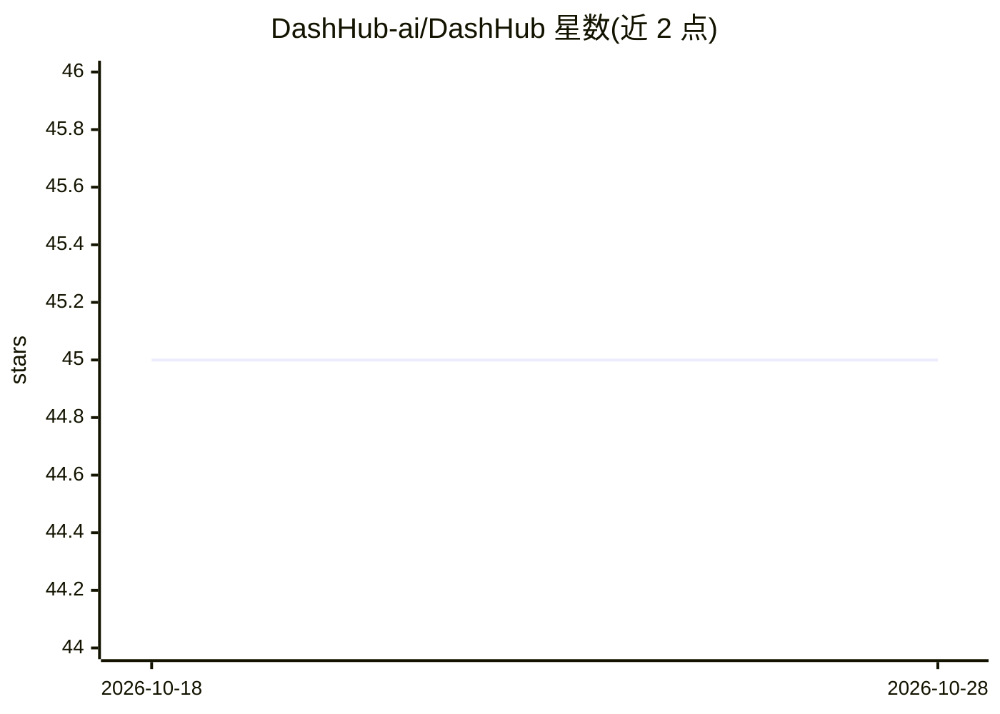

# DashHub-ai/DashHub

⭐ 45 · TypeScript · Apache-2.0 · 推送 2026-05-06 · [GitHub](https://github.com/DashHub-ai/DashHub) · [官网](https://dashhub.ai) · 组织维护

**团队自托管的 AI 工作台：统一接入多模型共享协作**

面向团队的自托管 AI 工作区，通过一个私有界面让全体成员共享访问 GPT-4、Claude、Gemini、DeepSeek 及经 Ollama 部署的本地模型，支持任意 OpenAI 兼容端点。功能包括 MCP 工具服务器接入、项目与向量检索知识库、自定义 Agent、角色权限（Admin/Tech/User）、Elasticsearch 全文+语义搜索、MinIO S3 兼容存储。技术栈为 TypeScript monorepo（Hono 后端、React+Vite 前端），以 Docker Compose 快速启动。

## 筛选速览

| 维度 | 判定 | 备注 |
|---|---|---|
| AI 角色 | `ai-ecosystem` | LLM/agent 周边工具 |
| 许可风险 | `permissive` | Apache-2.0 |
| 部署形态 | `self-host` | docker 或自建部署 |
| 模型依赖 | local-ok | 支持本地模型 |
| 硬件要求 | — | 无带数字的原话,不猜 |
| 安装摩擦 | `low` | 无编译、无系统依赖或容器化 |
| 成熟度 | — | 结构信号不足 |

## 能力要点

- 多模型统一接入，含 Ollama 本地模型与 OpenAI 兼容端点
- MCP 工具服务器接入数据库、API、文件系统
- 项目级知识库与全文+向量搜索
- 三角色权限体系与按项目授权

## 适用场景

- 团队共享使用 GPT-4/Claude/Gemini 等模型而不按席位付费
- 在私有环境中构建带知识库的项目问答与自定义 Agent
- 通过 MCP 让 AI 访问内部数据库与 API 工具

## 场景标签

`聊天机器人` `知识库管理` · 领域:对话与助手

## 证据(README 行号)

> L12: DashHub is an open-source AI workspace that lets your entire team share access to GPT-4, Claude, Gemini, and local 
> L42: > **Next step:** Open the admin panel, create an organization, then add an AI model (OpenAI key, Ollama, or any Ope
> L47: Connect OpenAI, Anthropic Claude, Google Gemini, DeepSeek, and any OpenAI-compatible endpoint — including **local m

## 星数曲线

2026-10-18 45 → 2026-10-28 45（+0）

---
*卡片 v1 · prompt 1.4 · 生成 2026-10-25 · 置信度 high · 依据 README sha `490307031945` · [字段定义](../../DATASET.md)*
