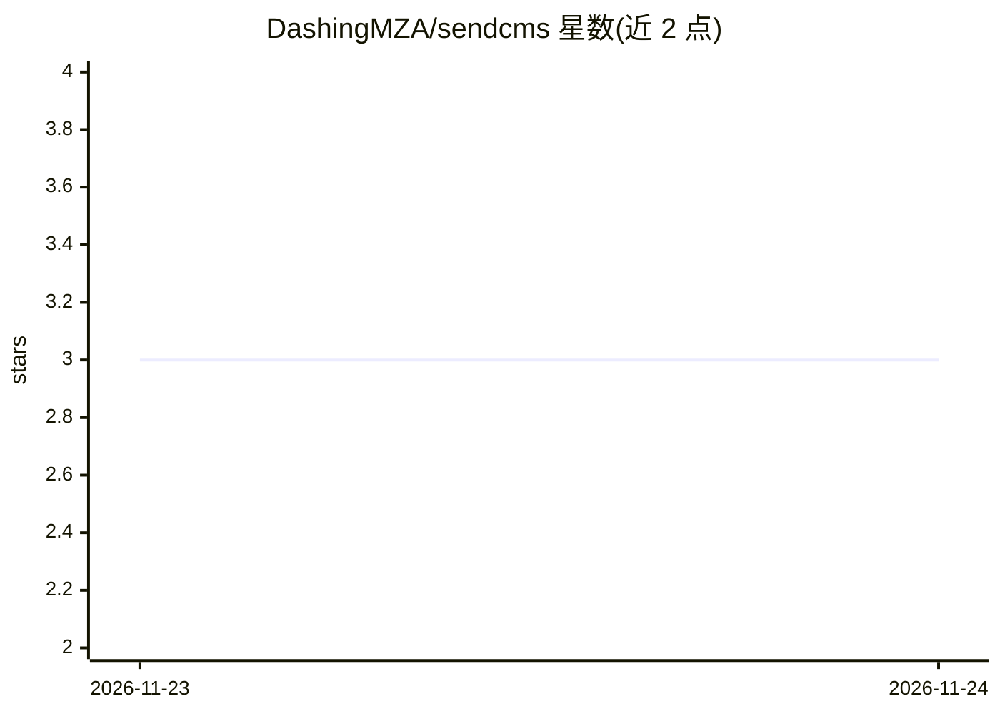

# DashingMZA/sendcms

⭐ 3 · TypeScript · MIT · 推送 2026-11-23 · [GitHub](https://github.com/DashingMZA/sendcms) · [官网](https://sendcms.bond) · 个人维护

**为任意网站提供托管联系表单后端的服务**

面向静态站与现代站点（Astro、Hugo、Next.js、WordPress、纯 HTML）的集中式表单后端：注册域名并验证所有权（DNS TXT / meta tag / 文件），创建表单后嵌入一段 script 标签，提交内容进入带搜索、过滤与批量操作的收件箱。提供提交 API（Origin 白名单、honeypot、Turnstile、速率限制、幂等）、7 KB 原生 TS SDK 与无 JS 回退、邮件通知与发件箱重试（Resend / SMTP）。技术栈为 Next.js + PostgreSQL (Prisma) + Better Auth，自托管需配置数据库、OAuth 与邮件等环境变量。

## 筛选速览

| 维度 | 判定 | 备注 |
|---|---|---|
| AI 角色 | `ai-enhanced` | 去掉 AI 部分产品仍成立 |
| 许可风险 | `permissive` | MIT |
| 部署形态 | `library` | 以包/库形式分发 |
| 模型依赖 | — | README 未给出锁定关系 |
| 硬件要求 | — | 无带数字的原话,不猜 |
| 安装摩擦 | `low` | 无编译、无系统依赖或容器化 |
| 成熟度 | — | 结构信号不足 |

## 能力要点

- 域名所有权验证（DNS TXT / meta tag / 文件）与一段 script 标签嵌入
- 提交 API 含 Origin 白名单、honeypot、Turnstile、速率限制与幂等
- 收件箱支持搜索、过滤、批量操作；邮件通知带发件箱重试
- vanilla-TS SDK（7 KB）与无 JS 表单回退

## 适用场景

- 为静态站点或无后端的网站接入联系表单
- 集中管理多个站点/域名的表单提交与通知
- 需要反垃圾与速率限制的公开提交接口

## 场景标签

 · 领域:Web 开发工具/表单服务

## 证据(README 行号)

> L1: # SendCMS — a contact-form backend for any website
> L3: A centralized contact-form backend for static and modern websites —
> L13: allowlist, honeypot, Turnstile, rate limits, idempotency · vanilla-TS

## 星数曲线

2026-11-23 3 → 2026-11-24 3（+0）

---
*卡片 v1 · prompt 1.4 · 生成 2026-11-23 · 置信度 mid · 依据 README sha `d75c232436d9` · [字段定义](../../DATASET.md)*
