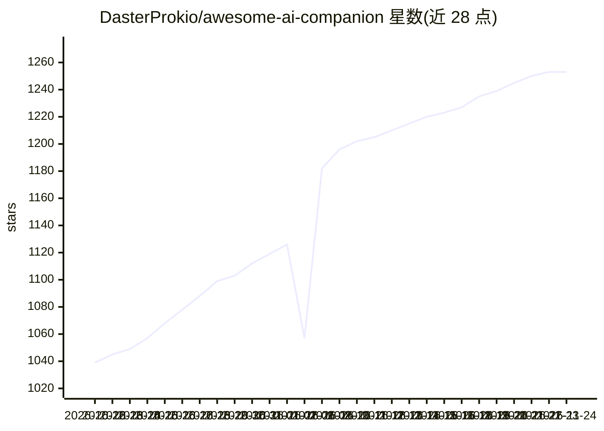

# DasterProkio/awesome-ai-companion

⭐ 1,258 · HTML · CC-BY-4.0 · 推送 2026-11-23 · [GitHub](https://github.com/DasterProkio/awesome-ai-companion) · [官网](https://lutopia.app/companion/) · 个人维护 · 中文 README

**人机恋/长期 AI 伴侣开源项目大全清单**

面向长期 AI 伴侣关系的开源项目聚合清单，收录伴侣客户端、桌面宠物、虚拟手机、长期记忆与主动聊天类项目，中英双语。每条条目标注代码实际功能、语言、运行平台（Android/iOS/Windows/Web/Self-host 等）与状态标签（ready/adapt/infra/verify）。清单声称逐项目阅读代码、对新收录项目做恶意代码扫描，未完成或不明晰的条目以 verify/adapt 标记提示读者自行核验。

## 筛选速览

| 维度 | 判定 | 备注 |
|---|---|---|
| AI 角色 | `ai-knowledge` | 知识聚合/清单类 |
| 许可风险 | `viral` | CC-BY-4.0 |
| 部署形态 | `None` |  |
| 模型依赖 | — | README 未给出锁定关系 |
| 硬件要求 | — | 无带数字的原话,不猜 |
| 安装摩擦 | `medium` | 含编译或系统依赖之一 |
| 成熟度 | — | 结构信号不足 |

## 能力要点

- 逐项目读代码并撰写实际功能描述
- 新条目自动扫描恶意代码模式与已知漏洞依赖
- 统一的状态标签体系（ready/adapt/infra/verify）与平台标注
- 中英双语条目，含多个中文社区项目

## 适用场景

- 想自托管一个带长期记忆的 AI 伴侣应用时选型
- 查找 Android/iOS 上的伴侣聊天客户端或桌面宠物项目
- 了解虚拟手机、伴侣空间这类条目的生态现状

## 场景标签

`精选清单` `聊天机器人` · 领域:对话与助手

## 证据(README 行号)

> L8:  Software, infrastructure, and communities for long-term AI companion relationships.
> L13: We read the code of every project here, and each description says what it actually does.
> L23: ## Companion Clients & Workspaces

## 星数曲线

2026-10-22 1,039 → 2026-11-24 1,253（+214）

---
*卡片 v1 · prompt 1.4 · 生成 2026-11-24 · 置信度 high · 依据 README sha `9e790976300d` · [字段定义](../../DATASET.md)*
