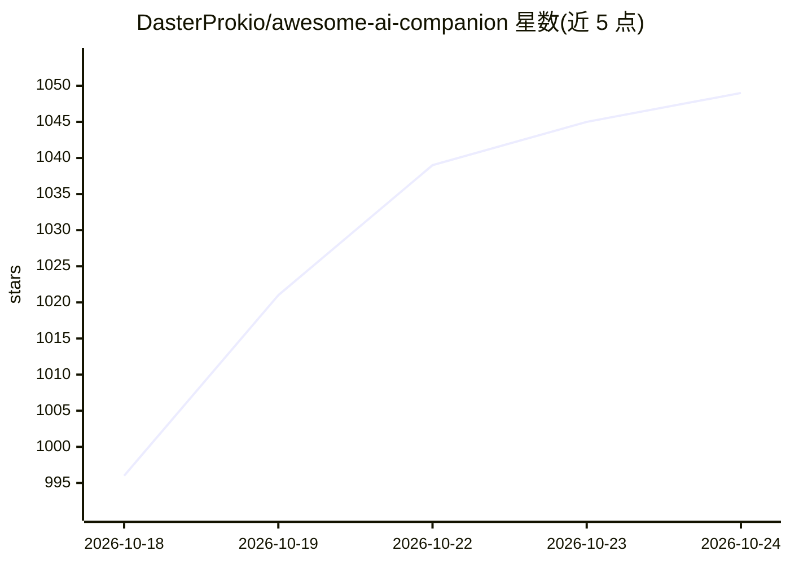

# DasterProkio/awesome-ai-companion

⭐ 1,057 · HTML · CC-BY-4.0 · 推送 2026-10-24 · [GitHub](https://github.com/DasterProkio/awesome-ai-companion) · [官网](https://lutopia.app/companion/) · 个人维护 · 中文 README

**长期 AI 伴侣开源项目清单：客户端、虚拟手机、社区与基础设施**

由个人维护的 awesome 类策展清单，收录面向长期 AI 伴侣关系的开源软件、基础设施与社区资源。可见部分覆盖两大板块：伴侣客户端与工作区（Android/iOS/桌面/自托管聊天应用、Claude Code 宿主方案）以及虚拟手机与伴侣空间（虚拟小屋、微信式聊天界面等）。每条目标注语言、平台、状态（ready/adapt/infra/verify）与许可证，维护者声明阅读过每个项目的代码并对新条目做恶意代码扫描。

## 筛选速览

| 维度 | 判定 | 备注 |
|---|---|---|
| AI 角色 | `ai-knowledge` | 知识聚合/清单类 |
| 许可风险 | `viral` | CC-BY-4.0 |
| 部署形态 | `None` |  |
| 模型依赖 | — | README 未给出锁定关系 |
| 硬件要求 | — | 无带数字的原话,不猜 |
| 安装摩擦 | `medium` | 含编译或系统依赖之一 |
| 成熟度 | — | 结构信号不足 |

## 能力要点

- 条目按 Status（ready/adapt/infra/verify）与 Platform（Android/iOS/Web/Self-host/CLI 等）双维度标注
- 覆盖伴侣客户端、Claude Code 宿主运行时、虚拟手机/伴侣空间等板块
- 声明逐项阅读代码并自动扫描恶意代码与已知漏洞依赖
- 提供中英双语版本

## 适用场景

- 寻找支持长期记忆与主动消息的 AI 伴侣客户端
- 了解基于 Claude Code 搭建本地伴侣会话的方案
- 查找虚拟手机/桌面宠物类伴侣界面项目

## 场景标签

`精选清单` · 领域:学习与行业

## 证据(README 行号)

> L5:  Awesome AI Companion
> L8:  Software, infrastructure, and communities for long-term AI companion relationships.
> L13: We read the code of every project here, and each description says what it actually does.

## 星数曲线

2026-10-18 996 → 2026-10-24 1,049（+53）

---
*卡片 v1 · prompt 1.4 · 生成 2026-10-21 · 置信度 high · 依据 README sha `a636f55bcc4c` · [字段定义](../../DATASET.md)*
