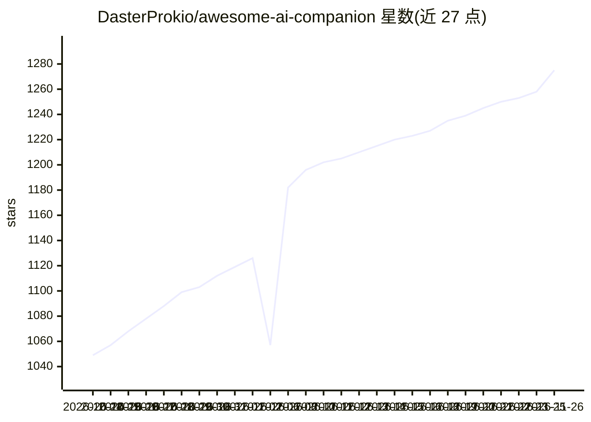

# DasterProkio/awesome-ai-companion

⭐ 1,275 · HTML · CC-BY-4.0 · 推送 2026-11-25 · [GitHub](https://github.com/DasterProkio/awesome-ai-companion) · [官网](https://lutopia.app/companion/) · 个人维护 · 中文 README

**AI 伴侣/桌面宠物开源项目清单：帮人找自托管伴侣方案**

面向长期 AI 伴侣关系需求者的开源项目聚合清单，收录伴侣客户端、虚拟手机、伴侣空间、记忆与主动性基础设施及社区等类别的项目。每条条目附维护者读码后的描述、状态标签（ready/adapt/infra/verify）、平台标签与许可证信息，新收录条目自动扫描恶意代码模式与已知漏洞依赖，未完成或不明项目标记 verify 或 adapt。README 双语呈现，未提供本产品自身的安装方式。

## 筛选速览

| 维度 | 判定 | 备注 |
|---|---|---|
| AI 角色 | `ai-knowledge` | 知识聚合/清单类 |
| 许可风险 | `viral` | CC-BY-4.0 |
| 部署形态 | `None` |  |
| 模型依赖 | — | README 未给出锁定关系 |
| 硬件要求 | — | 无带数字的原话,不猜 |
| 安装摩擦 | `medium` | 含编译或系统依赖之一 |
| 成熟度 | — | 结构信号不足 |

## 能力要点

- 收录项目逐一经代码阅读，描述其实际功能
- 新条目自动扫描恶意代码模式与已知漏洞依赖
- 每条带 ready/adapt/infra/verify 状态与平台标签
- 双语（English/中文版）呈现

## 适用场景

- 为自托管 AI 伴侣挑选合适的客户端或框架
- 查找带长期记忆与主动消息能力的桌面宠物项目
- 按平台（Android/iOS/Windows/Web）筛选伴侣应用

## 场景标签

`精选清单` · 领域:学习与行业

## 证据(README 行号)

> L8:  Software, infrastructure, and communities for long-term AI companion relationships.
> L13: We read the code of every project here, and each description says what it actually does.

## 星数曲线

2026-10-24 1,049 → 2026-11-26 1,275（+226）

---
*卡片 v1 · prompt 1.4 · 生成 2026-11-26 · 置信度 high · 依据 README sha `663f0a018564` · [字段定义](../../DATASET.md)*
