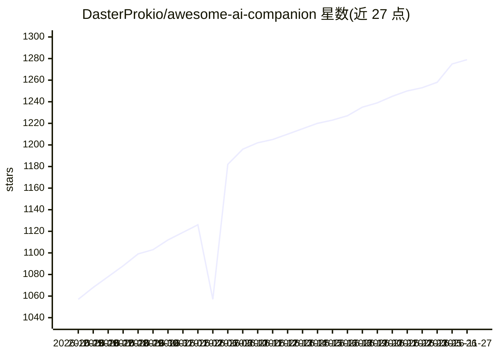

# DasterProkio/awesome-ai-companion

⭐ 1,279 · HTML · CC-BY-4.0 · 推送 2026-11-26 · [GitHub](https://github.com/DasterProkio/awesome-ai-companion) · [官网](https://lutopia.app/companion/) · 个人维护 · 中文 README

**面向长期 AI 伴侣关系的开源项目清单**

以 Awesome 清单形式收录 AI 伴侣/桌面宠物/长期记忆/主动性对话相关的开源软件、基础设施与社区，条目按伴侣客户端工作区、虚拟手机等分区组织。每条附语言、平台（Android/iOS/Web/Self-host/CLI）、许可证、成熟度标签（ready/adapt/infra/verify），并声明对收录项目做了代码阅读、恶意代码扫描与自动扫描新条目。中英双语，不提供可安装产品本体。

## 筛选速览

| 维度 | 判定 | 备注 |
|---|---|---|
| AI 角色 | `ai-knowledge` | 知识聚合/清单类 |
| 许可风险 | `viral` | CC-BY-4.0 |
| 部署形态 | `None` |  |
| 模型依赖 | — | README 未给出锁定关系 |
| 硬件要求 | — | 无带数字的原话,不猜 |
| 安装摩擦 | `medium` | 含编译或系统依赖之一 |
| 成熟度 | — | 结构信号不足 |

## 能力要点

- 条目标注成熟度标签（ready/adapt/infra/verify）与运行平台
- 声明逐项目读代码、扫描恶意代码与已知漏洞依赖
- 中英双语条目收录，含多个中文社区项目

## 适用场景

- 寻找可自托管的 AI 伴侣或桌面宠物项目
- 按平台（Android/iOS/Web/Self-host）筛选伴侣类应用
- 了解虚拟手机、伴侣前端等生态的现状

## 场景标签

`精选清单` `聊天机器人` · 领域:对话与助手

## 证据(README 行号)

> L6:  Awesome
> L8:  Software, infrastructure, and communities for long-term AI companion relationships.
> L21: ## Contents

## 星数曲线

2026-10-25 1,057 → 2026-11-27 1,279（+222）

---
*卡片 v1 · prompt 1.4 · 生成 2026-11-27 · 置信度 high · 依据 README sha `61fa7ee5c0cb` · [字段定义](../../DATASET.md)*
