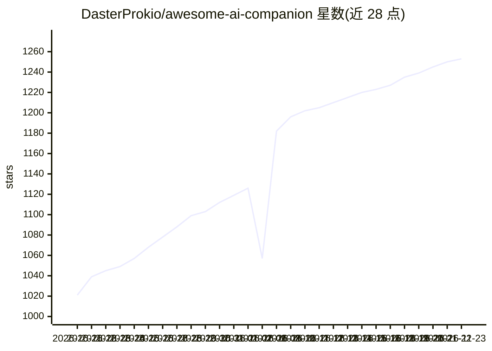

# DasterProkio/awesome-ai-companion

⭐ 1,253 · HTML · CC-BY-4.0 · 推送 2026-11-22 · [GitHub](https://github.com/DasterProkio/awesome-ai-companion) · [官网](https://lutopia.app/companion/) · 个人维护 · 中文 README

**面向长期 AI 伴侣关系的开源项目策展清单**

以 Awesome 清单形式聚合 AI 伴侣、桌面宠物、长期记忆与主动对话相关的开源软件、基础设施与社区条目。每个条目附一句功能描述，并标注状态标签（ready/adapt/infra/verify）、运行平台（Android/iOS/Web/Self-host/CLI 等）、编程语言与许可证。清单声明逐条阅读过代码、自动扫描新收录项目的恶意代码与已知漏洞依赖，未完成或不明条目加 verify/adapt 标记。内容按伴侣客户端、虚拟手机与伴侣空间等类别组织，中英双语。

## 筛选速览

| 维度 | 判定 | 备注 |
|---|---|---|
| AI 角色 | `ai-knowledge` | 知识聚合/清单类 |
| 许可风险 | `viral` | CC-BY-4.0 |
| 部署形态 | `None` |  |
| 模型依赖 | — | README 未给出锁定关系 |
| 硬件要求 | — | 无带数字的原话,不猜 |
| 安装摩擦 | `medium` | 含编译或系统依赖之一 |
| 成熟度 | — | 结构信号不足 |

## 能力要点

- 按伴侣客户端、虚拟手机/伴侣空间等类别组织的策展清单
- 每条目标注状态（ready/adapt/infra/verify）与平台
- 声明逐条读码并对新条目自动扫描恶意代码与漏洞依赖
- 中英双语条目，含多个中文项目（橘瓣、柚月小手机、汪汪机等）

## 适用场景

- 为自建 AI 伴侣或桌面宠物寻找可用的开源客户端与自托管方案
- 筛选支持长期记忆与主动消息的伴侣应用条目
- 按许可证与平台标签筛选适合 Android/iOS/Self-host 的项目

## 场景标签

`精选清单` · 领域:学习与行业

## 证据(README 行号)

> L8:  Software, infrastructure, and communities for long-term AI companion relationships.
> L9:  人机恋开源项目大全 · 面向长期 AI 伴侣关系的开源软件、基础设施与社区。
> L21: ## Contents

## 星数曲线

2026-10-21 1,021 → 2026-11-23 1,253（+232）

---
*卡片 v1 · prompt 1.4 · 生成 2026-11-23 · 置信度 high · 依据 README sha `69ff9ddf2561` · [字段定义](../../DATASET.md)*
