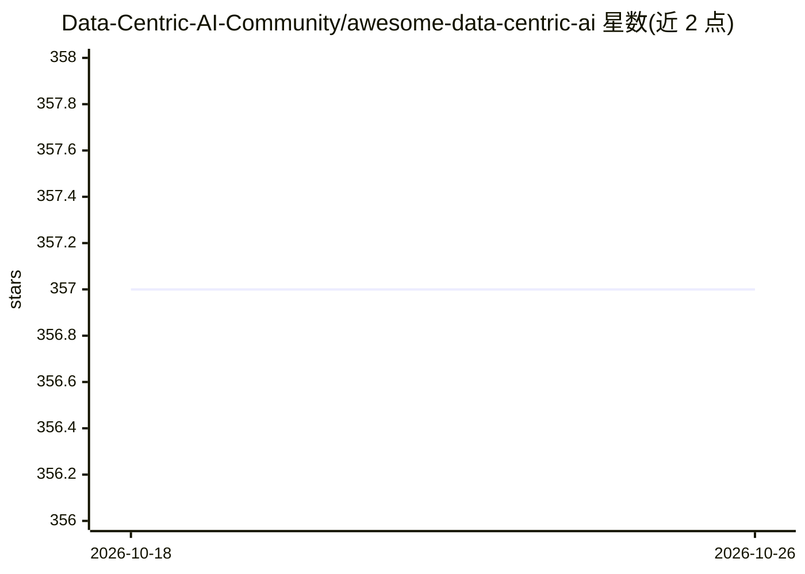

# Data-Centric-AI-Community/awesome-data-centric-ai

⭐ 357 · Jupyter Notebook · MIT · 推送 2026-09-29 · [GitHub](https://github.com/Data-Centric-AI-Community/awesome-data-centric-ai) · 组织维护

**以数据为中心的 AI 资源策展清单：库/教程/课程/基准**

Data-Centric AI Community 维护的 awesome 清单，收录以训练数据（而非模型）为 AI 开发核心的开源资源：按数据画像、合成数据、数据标注、数据准备、教程、课程、基准等类别组织，条目含 YData Profiling、SDV、Label Studio、DataFlow 等工具及 MIT 数据中心 AI 课程、综述论文、REFUTE 基准。面向想入门或选型数据中心 AI 工具链的开发者与数据从业者，接受社区 PR 贡献，并链接 Discord/Medium/YouTube 社区渠道。本身不含代码，仅提供条目名称与一句话介绍。

## 筛选速览

| 维度 | 判定 | 备注 |
|---|---|---|
| AI 角色 | `ai-knowledge` | 知识聚合/清单类 |
| 许可风险 | `permissive` | MIT |
| 部署形态 | `None` |  |
| 模型依赖 | — | README 未给出锁定关系 |
| 硬件要求 | — | 无带数字的原话,不猜 |
| 安装摩擦 | `low` | 无编译、无系统依赖或容器化 |
| 成熟度 | — | 结构信号不足 |

## 能力要点

- 按数据画像/合成数据/标注/准备等类别组织的工具清单
- 含数据中心 AI 综述论文与 MIT 课程等学习资源
- 收录 LLM 训练数据准备工具（DataFlow、dtflow）与 REFUTE 基准
- 开放 PR 贡献并有配套社区渠道

## 适用场景

- 寻找数据画像或合成数据生成的开源工具
- 为标注任务挑选图像/音频/文本标注工具
- 系统学习数据中心 AI 的课程与综述材料

## 场景标签

`精选清单` · 领域:学习与行业

## 证据(README 行号)

> L14: This repository contains a curated list of awesome resources such as open-source libraries, tutorials, and articles
> L18: ## 📊 Data Profiling

## 星数曲线

2026-10-18 357 → 2026-10-26 357（+0）

---
*卡片 v1 · prompt 1.4 · 生成 2026-10-21 · 置信度 high · 依据 README sha `7da1e66ea7ae` · [字段定义](../../DATASET.md)*
