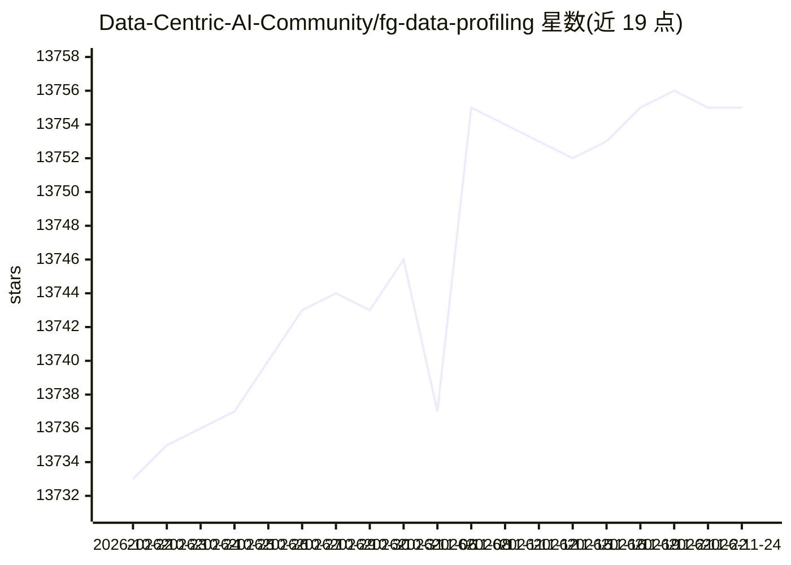

# Data-Centric-AI-Community/fg-data-profiling

⭐ 13,757 · Python · MIT · 推送 2026-11-16 · [GitHub](https://github.com/Data-Centric-AI-Community/fg-data-profiling) · [官网](https://docs.sdk.ydata.ai) · 组织维护

**一行代码生成 Pandas/Spark DataFrame 数据质量剖析报告**

基于 ydata-profiling 更名而来的 Python 包，对 DataFrame 进行探索性数据分析：类型推断、缺失/偏斜等质量警告、单变量与多变量统计、时间序列与文本分析、文件与图像分析、数据集对比，报告可导出为 HTML/JSON 或嵌入 Jupyter。提供命令行工具处理 CSV。支持 Spark 后端处理大数据集，需 Python 3，报告渲染需现代浏览器。

## 筛选速览

| 维度 | 判定 | 备注 |
|---|---|---|
| AI 角色 | `ai-knowledge` | 知识聚合/清单类 |
| 许可风险 | `permissive` | MIT |
| 部署形态 | `library` | 以包/库形式分发 |
| 模型依赖 | — | README 未给出锁定关系 |
| 硬件要求 | — | 无带数字的原话,不猜 |
| 安装摩擦 | `low` | 无编译、无系统依赖或容器化 |
| 成熟度 | — | 结构信号不足 |

## 动量与使用信号

- 维护:`active` — 距上次 push 36.5 天,年发版 6,115 位贡献者
- 涨星:近 1 天 **-2**(自 20261016 起算)
- 安装:pypi 包 `fg-data-profiling` 月下载 14,461

## 能力要点

- 一行代码生成 EDA 剖析报告，可导出 HTML/JSON/Jupyter widget
- 自动类型推断与数据质量警告（缺失、高相关、偏斜、常量列等）
- 支持时间序列、文本、文件与图像分析
- 提供 Spark 支持（extras）用于大数据集

## 适用场景

- 快速了解新数据集的结构与质量问题
- 对比同一数据集的多个版本
- 为时间序列数据集一键生成剖析报告
- 在 Airflow/Kedro 等流水线中自动产出数据报告

## 场景标签

`数据分析` · 领域:效率与自动化

## 证据(README 行号)

> L25: `fg-data-profiling` primary goal is to provide a one-line Exploratory Data Analysis (EDA) experience in a consisten
> L108: - Want to scale? Check the latest release with ⭐⚡Spark support!

## 星数曲线

2026-10-22 13,733 → 2026-11-24 13,755（+22）

---
*卡片 v1 · prompt 1.4 · 生成 2026-11-22 · 置信度 high · 依据 README sha `66895650946c` · [字段定义](../../DATASET.md)*
