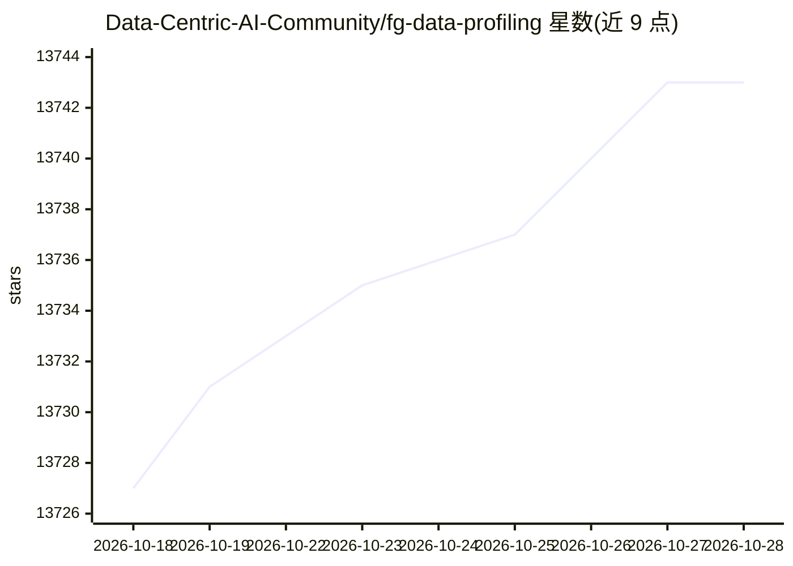

# Data-Centric-AI-Community/fg-data-profiling

⭐ 13,744 · Python · MIT · 推送 2026-09-11 · [GitHub](https://github.com/Data-Centric-AI-Community/fg-data-profiling) · [官网](https://docs.sdk.ydata.ai) · 组织维护

**一行代码生成 DataFrame 数据质量剖析与 EDA 报告**

ydata-profiling 更名后的 Python 包，为 Pandas 与 Spark DataFrame 提供一行式探索性数据分析：类型推断、缺失/偏斜等质量警告、单变量与多变量统计、时间序列与文本分析、文件与图像元信息、数据集对比，报告可导出为 HTML/JSON 或 Jupyter widget。支持 pip/conda/源码安装与 CLI 处理 CSV。需 Python 3，报告渲染需现代浏览器；数据库级剖析引导至 YData Fabric 商业产品。

## 筛选速览

| 维度 | 判定 | 备注 |
|---|---|---|
| AI 角色 | `ai-ecosystem` | LLM/agent 周边工具 |
| 许可风险 | `permissive` | MIT |
| 部署形态 | `library` | 以包/库形式分发 |
| 模型依赖 | — | README 未给出锁定关系 |
| 硬件要求 | — | 无带数字的原话,不猜 |
| 安装摩擦 | `low` | 无编译、无系统依赖或容器化 |
| 成熟度 | — | 结构信号不足 |

## 动量与使用信号

- 维护:`active` — 距上次 push 36.5 天,年发版 6,115 位贡献者
- 涨星:近 1 天 **-2**(自 20261016 起算)
- 安装:pypi 包 `fg-data-profiling` 月下载 14,461

## 能力要点

- 一行代码生成剖析报告，支持 HTML/JSON/Jupyter widget 导出
- 支持 Pandas 与 Spark（pyspark extra）处理大规模数据
- 覆盖时间序列、文本（Unicode）、文件与图像分析
- 提供 CLI 直接处理 CSV 文件

## 适用场景

- 建模前快速审查数据集质量与分布
- 对比同一数据集的多个版本
- 为大规模数据集生成剖析报告
- 在 Jupyter 中交互式探索数据

## 场景标签

`数据分析` · 领域:效率与自动化

## 证据(README 行号)

> L25: `fg-data-profiling` primary goal is to provide a one-line Exploratory Data Analysis (EDA) experience in a consisten
> L93: - **Type inference**: automatic detection of columns' data types (*Categorical*, *Numerical*, *Date*, etc.)
> L111: - Want to scale? Check the latest release with ⭐⚡Spark support!

## 星数曲线

2026-10-18 13,727 → 2026-10-28 13,743（+16）

---
*卡片 v1 · prompt 1.4 · 生成 2026-10-18 · 置信度 high · 依据 README sha `5042087e1174` · [字段定义](../../DATASET.md)*
