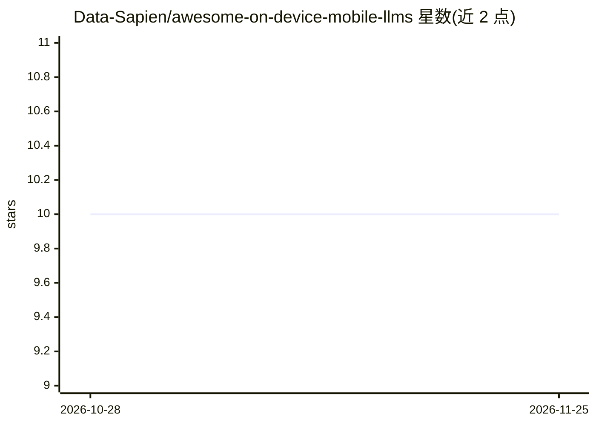

# Data-Sapien/awesome-on-device-mobile-llms

⭐ 10 · 推送 2026-06-22 · [GitHub](https://github.com/Data-Sapien/awesome-on-device-mobile-llms) · [官网](https://datasapien.com/) · 组织维护

**移动端本地 LLM 落地资源清单：运行时对比与选型实践**

由 DataSapien 团队维护的端侧 LLM 资源清单，收录移动端运行时对比（llama.cpp、LiteRT、Cactus、MLX 的平台/格式/加速支持）、模型三级选型方法、端侧意图分类器实测数据，以及 GDPR 友好的端侧架构讨论。内容同时展示其 Mobile SDK 的可插拔运行时工厂与 Journeys 远程发布机制，并附开发文档、教程与博客链接，面向需在手机应用中部署本地 LLM 的移动开发团队。

## 筛选速览

| 维度 | 判定 | 备注 |
|---|---|---|
| AI 角色 | `ai-knowledge` | 知识聚合/清单类 |
| 许可风险 | `none` | — |
| 部署形态 | `None` |  |
| 模型依赖 | — | README 未给出锁定关系 |
| 硬件要求 | — | 无带数字的原话,不猜 |
| 安装摩擦 | `low` | 无编译、无系统依赖或容器化 |
| 成熟度 | — | 结构信号不足 |

## 能力要点

- 四个端侧运行时的 Android/iOS 支持与加速方式对照表
- 三级模型选型方法（Gemma-3n/Qwen 2.5 SLM/Gemma 3 270M）与意图分类器实测延迟数据
- 按 GDPR 条款对比集中式与端侧架构的合规面分析
- Journeys 远程发布的端侧 agentic 流程配置机制

## 适用场景

- 为 Android/iOS 应用选择端侧 LLM 运行时与模型量化版本
- 在离线或隐私受限场景设计端侧推理架构
- 参考真实生产用例规划移动端 AI 功能上线

## 场景标签

`精选清单` · 领域:学习与行业

## 证据(README 行号)

> L1: # Awesome On-Device Mobile LLMs
> L5: Curated, battle-tested guidance for shipping on-edge LLMs in real mobile apps — not another generic model list.
> L175: *Maintained by the DataSapien engineering team.*

## 星数曲线

2026-10-28 10 → 2026-11-25 10（+0）

---
*卡片 v1 · prompt 1.4 · 生成 2026-11-20 · 置信度 high · 依据 README sha `b70e1e5b35a7` · [字段定义](../../DATASET.md)*
