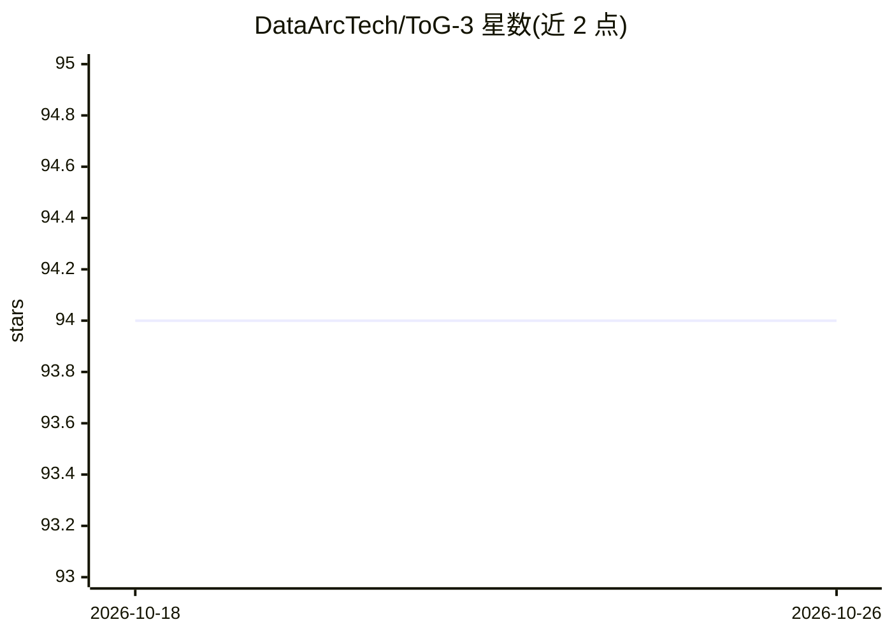

# DataArcTech/ToG-3

⭐ 94 · Python · MIT · 推送 2026-04-09 · [GitHub](https://github.com/DataArcTech/ToG-3) · 组织维护 · 中文 README

**构建多类 RAG 流水线的框架：含 GraphRAG 与多模态 RAG**

Think-on-Graph 3.0 / RAG-Factory 是用于构建 RAG 管道的框架，覆盖标准向量 RAG（基于 Qdrant）、Graph RAG（基于 Neo4j）与多模态 RAG（Neo4j 存储文本与图像向量）。提供模块化设计、可配置流水线组件、多 LLM 提供商接入与轻量级 SQLite 缓存；通过 run.sh 或 main.py 配置文件运行。规划中的功能包括 ReAct 查询引擎、查询重写、子问题分解与 Agentic RAG。配有 arXiv 论文与 Hugging Face 数据集/模型链接，面向构建检索增强系统的开发者。

## 筛选速览

| 维度 | 判定 | 备注 |
|---|---|---|
| AI 角色 | `ai-ecosystem` | LLM/agent 周边工具 |
| 许可风险 | `permissive` | MIT |
| 部署形态 | `library` | 以包/库形式分发 |
| 模型依赖 | — | README 未给出锁定关系 |
| 硬件要求 | — | 无带数字的原话,不猜 |
| 安装摩擦 | `low` | 无编译、无系统依赖或容器化 |
| 成熟度 | — | 结构信号不足 |

## 能力要点

- 支持向量 RAG、Graph RAG、多模态 RAG 三类管道
- 多知识图谱后端与多 LLM 提供商接入
- 模块化设计与可配置流水线组件
- 轻量级 SQLite 缓存方案

## 适用场景

- 构建基于知识图谱的 GraphRAG 问答系统
- 搭建文本与图像联合检索的多模态 RAG 应用
- 通过示例配置快速实验不同 RAG 架构

## 场景标签

`RAG` `知识图谱` `多模态` · 领域:知识与检索

## 证据(README 行号)

> L18: A factory for building advanced RAG (Retrieval-Augmented Generation) pipelines, including:
> L21: - GraphRAG architectures
> L30: - Integration with multiple LLM providers

## 星数曲线

2026-10-18 94 → 2026-10-26 94（+0）

---
*卡片 v1 · prompt 1.4 · 生成 2026-10-23 · 置信度 high · 依据 README sha `d83b1a772600` · [字段定义](../../DATASET.md)*
