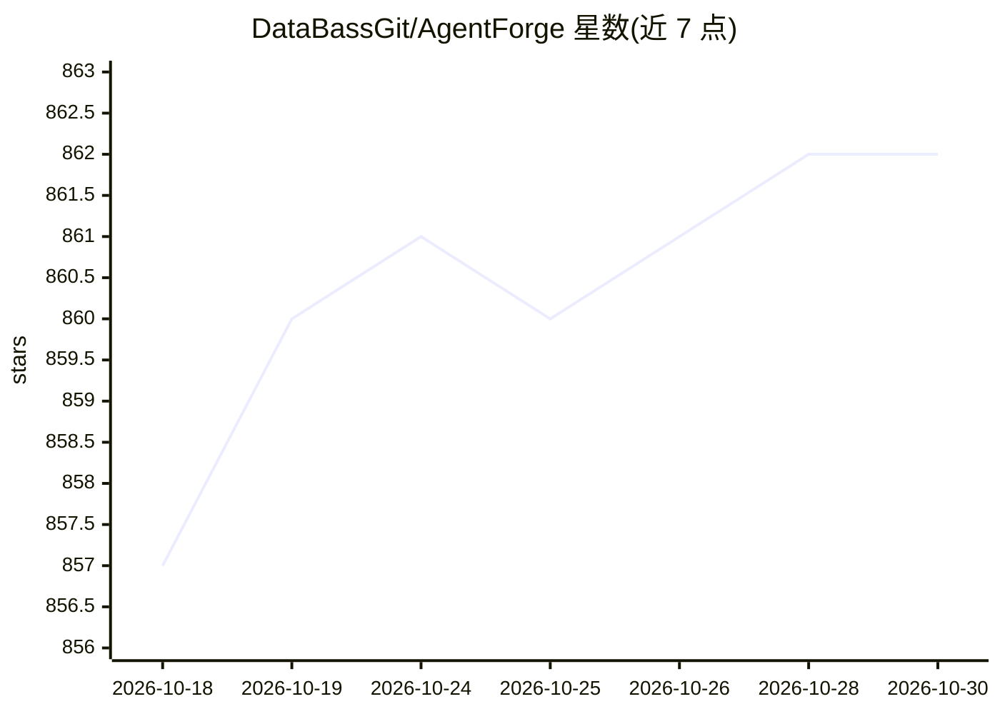

# DataBassGit/AgentForge

⭐ 862 · Python · GPL-3.0 · 推送 2026-08-10 · [GitHub](https://github.com/DataBassGit/AgentForge) · 组织维护

**低代码 AI Agent 与认知架构开发框架**

AgentForge 是一个用于快速开发、测试与迭代 AI 自主 agent 与认知架构的低代码 Python 框架。核心概念包括灵活的 Agent、声明式 YAML Cog 工作流与可选的集成记忆，支持多 agent 编排、分支逻辑、Persona 配置、动态提示模板与实时提示编辑。模型层面兼容 OpenAI、Gemini、Anthropic Claude 及通过 Ollama/LMStudio 运行的本地模型，可为不同 agent 指定不同 LLM。以 PyPI 包与文档形式提供，含无凭证的调试冒烟测试路径，采用 GPL v3 许可。

## 筛选速览

| 维度 | 判定 | 备注 |
|---|---|---|
| AI 角色 | `ai-ecosystem` | LLM/agent 周边工具 |
| 许可风险 | `viral` | GPL-3.0 |
| 部署形态 | `library` | 以包/库形式分发 |
| 模型依赖 | local-ok | 支持本地模型 |
| 硬件要求 | — | 无带数字的原话,不猜 |
| 安装摩擦 | `low` | 无编译、无系统依赖或容器化 |
| 成熟度 | — | 结构信号不足 |

## 能力要点

- 声明式 YAML Cogs 编排多 agent 工作流与分支逻辑
- 集成上下文记忆与 Persona 配置
- LLM 无关：不同 agent 可用不同模型（OpenAI/Gemini/Claude/Ollama/LMStudio）
- 运行时实时编辑提示模板，无需重启

## 适用场景

- 快速搭建与迭代多 agent 系统
- 用本地模型（Ollama/LMStudio）运行低代码 agent 工作流
- 为 agent 添加上下文记忆与角色配置

## 场景标签

`多智能体` `Agent 框架` · 领域:Agent 开发

## 证据(README 行号)

> L11: **AgentForge** is a low-code framework for rapid development, testing, and iteration of AI-powered autonomous agent
> L13: Compatible with a range of LLM models—including OpenAI, Google's Gemini, Anthropic's Claude, and local models via O

## 星数曲线

2026-10-18 857 → 2026-10-30 862（+5）

---
*卡片 v1 · prompt 1.4 · 生成 2026-10-21 · 置信度 high · 依据 README sha `82a6eb1d190e` · [字段定义](../../DATASET.md)*
