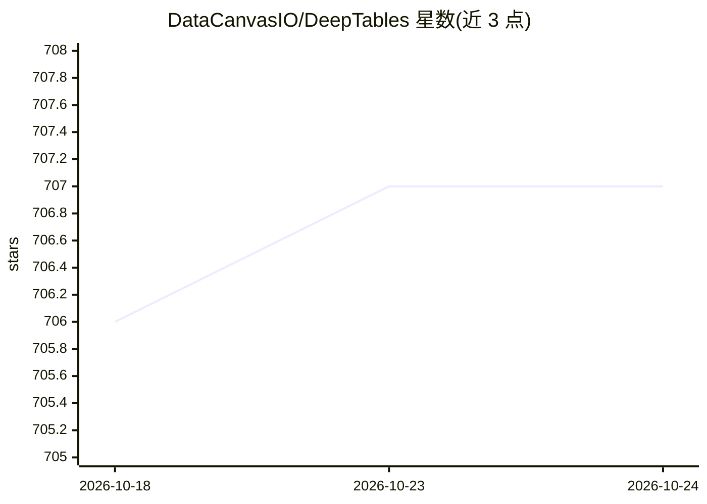

# DataCanvasIO/DeepTables

⭐ 707 · Python · Apache-2.0 · 推送 2026-04-20 · [GitHub](https://github.com/DataCanvasIO/DeepTables) · [官网](https://deeptables.readthedocs.io) · 组织维护

**面向表格数据的深度学习工具包，覆盖 CTR 预测模型族**

DataCanvas 开源的 Python 工具包，将 FM、DeepFM、Wide&Deep、DCN、PNN 等面向 CTR 预测的深度学习模型封装为端到端表格数据建模流程，开箱即用且支持用户自定义扩展架构。用户通过 pip 安装 TensorFlow 与 deeptables 后即可用少量代码完成二分类等任务，GPU 使用可选安装 tensorflow-gpu，shap 为可选依赖。附 Kaggle Categorical Feature Encoding Challenge II 第一名方案示例与 readthedocs 文档。

## 筛选速览

| 维度 | 判定 | 备注 |
|---|---|---|
| AI 角色 | `ai-native` | 本体是模型或模型工具 |
| 许可风险 | `permissive` | Apache-2.0 |
| 部署形态 | `library` | 以包/库形式分发 |
| 模型依赖 | — | README 未给出锁定关系 |
| 硬件要求 | — | 无带数字的原话,不猜 |
| 安装摩擦 | `low` | 无编译、无系统依赖或容器化 |
| 成熟度 | — | 结构信号不足 |

## 能力要点

- 封装 FM/DeepFM/Wide&Deep/DCN/PNN 等表格数据深度学习模型
- 端到端建模流程，声明非专家也可使用
- pip 安装，CPU/GPU 均可运行，附安装验证命令
- 提供 Kaggle 类别特征编码挑战赛第一名的应用方案

## 适用场景

- 用深度学习模型直接做表格数据的分类/CTR 预测
- 不想手工做特征工程时快速获得基线模型
- 复现或扩展 DeepFM/DCN 等模型用于结构化数据实验

## 场景标签

`推荐系统` · 领域:学习与行业

## 证据(README 行号)

> L16: ## DeepTables: Deep-learning Toolkit for Tabular data
> L23: Various models have been proposed to CTR prediction and continue to outperform existing state-of-the-art approaches
> L25: DT aims to utilize the latest research findings to provide users with an end-to-end toolkit on tabular data.

## 星数曲线

2026-10-18 706 → 2026-10-24 707（+1）

---
*卡片 v1 · prompt 1.4 · 生成 2026-10-21 · 置信度 high · 依据 README sha `6d434643ffde` · [字段定义](../../DATASET.md)*
