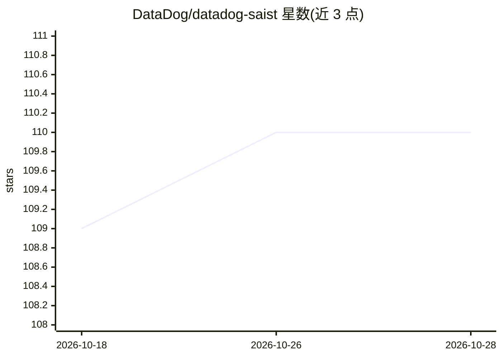

# DataDog/datadog-saist

⭐ 110 · Go · Apache-2.0 · 推送 2026-10-27 · [GitHub](https://github.com/DataDog/datadog-saist) · [官网](https://docs.datadoghq.com/security/code_security/) · 组织维护

**用 LLM 检测代码漏洞的静态安全测试工具**

Datadog 开源的 AI SAST 命令行工具：通过 Claude、GPT、Gemini 等 LLM（需提供 API key，无需 Datadog 账号）替代纯规则解析来检测安全漏洞，支持 Go、Java、Python、C# 等 13 种以上语言，构建项目上下文以辅助分析，并输出 SARIF 格式报告。检测规则默认从 Datadog 公开 API 端点获取，也可使用二进制内嵌规则离线运行。项目处于 preview 阶段，可用 make build 编译后独立运行。

## 筛选速览

| 维度 | 判定 | 备注 |
|---|---|---|
| AI 角色 | `ai-native` | 本体是模型或模型工具 |
| 许可风险 | `permissive` | Apache-2.0 |
| 部署形态 | `None` |  |
| 模型依赖 | locked-api |  |
| 硬件要求 | — | 无带数字的原话,不猜 |
| 安装摩擦 | `low` | 无编译、无系统依赖或容器化 |
| 成熟度 | `idea` | |

## 能力要点

- 使用 LLM（Anthropic/OpenAI/Gemini）进行漏洞检测与结果验证
- 支持 13 种以上编程语言，输出 SARIF 标准报告
- 无需 Datadog 账号，检测规则从公开 API 获取或内嵌离线使用
- 支持 AI Gateway 接入与跨文件上下文索引

## 适用场景

- 在本地对代码仓库做 LLM 驱动的漏洞扫描
- 生成 SARIF 报告接入 CI/安全工作流
- 借助跨文件上下文分析多文件间的漏洞

## 场景标签

`代码审查` `网络安全` · 领域:编码与开发

## 证据(README 行号)

> L3:  This project is an AI-Native SAST tool. Unlike traditional SAST tools that rely solely on
> L16:  - **AI-Powered Analysis**: Uses advanced AI models to detect security vulnerabilities

## 星数曲线

2026-10-18 109 → 2026-10-28 110（+1）

---
*卡片 v1 · prompt 1.4 · 生成 2026-10-23 · 置信度 high · 依据 README sha `fa9dcffd25c5` · [字段定义](../../DATASET.md)*
