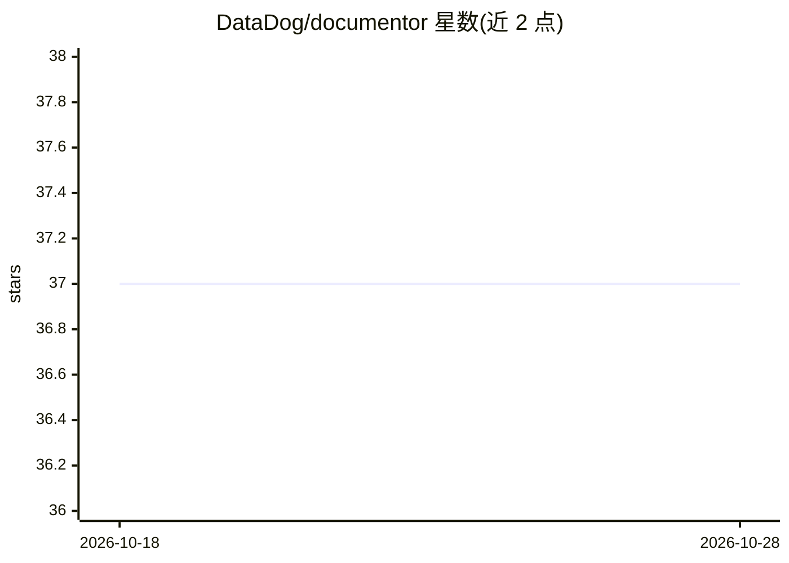

# DataDog/documentor

⭐ 37 · Go · Apache-2.0 · 推送 2026-06-16 · [GitHub](https://github.com/DataDog/documentor) · 组织维护

**AI 审阅与起草技术文档的命令行工具**

用 Go 编写的命令行应用，面向技术文档写作者：调用 LLM 对文档文件给出改进反馈的 review 命令、根据笔记草拟文档的 draft 命令，以及描述图片内容或生成图片文件名的 describe 命令。默认 AI 提供商为 OpenAI，可切换 Anthropic 并指定模型，通过 --key 或环境变量传入 API key；输出为 Markdown，可配合 glow 渲染。从源码编译安装，需 Go 1.24+、make 与 scdoc。

## 筛选速览

| 维度 | 判定 | 备注 |
|---|---|---|
| AI 角色 | `ai-native` | 本体是模型或模型工具 |
| 许可风险 | `permissive` | Apache-2.0 |
| 部署形态 | `None` |  |
| 模型依赖 | — | README 未给出锁定关系 |
| 硬件要求 | — | 无带数字的原话,不猜 |
| 安装摩擦 | `medium` | 含编译或系统依赖之一 |
| 成熟度 | — | 结构信号不足 |

## 能力要点

- review 命令对文档生成改进反馈
- draft 命令基于笔记起草文档
- describe 命令描述图片并可选生成文件名
- 支持 OpenAI（默认）与 Anthropic 提供商及指定模型

## 适用场景

- 让 AI 审阅我的技术文档并给出修改建议
- 根据笔记快速起草新文档
- 为图片生成内容描述或合适的文件名

## 场景标签

`AI 写作` · 领域:内容生成

## 证据(README 行号)

> L4: application that uses the power of AI to review documentation and
> L101: documentor --provider 'anthropic' --key 'your-anthropic-api-key' draft '/path/to/notes/file.md'

## 星数曲线

2026-10-18 37 → 2026-10-28 37（+0）

---
*卡片 v1 · prompt 1.4 · 生成 2026-10-25 · 置信度 high · 依据 README sha `d27e08e7c510` · [字段定义](../../DATASET.md)*
