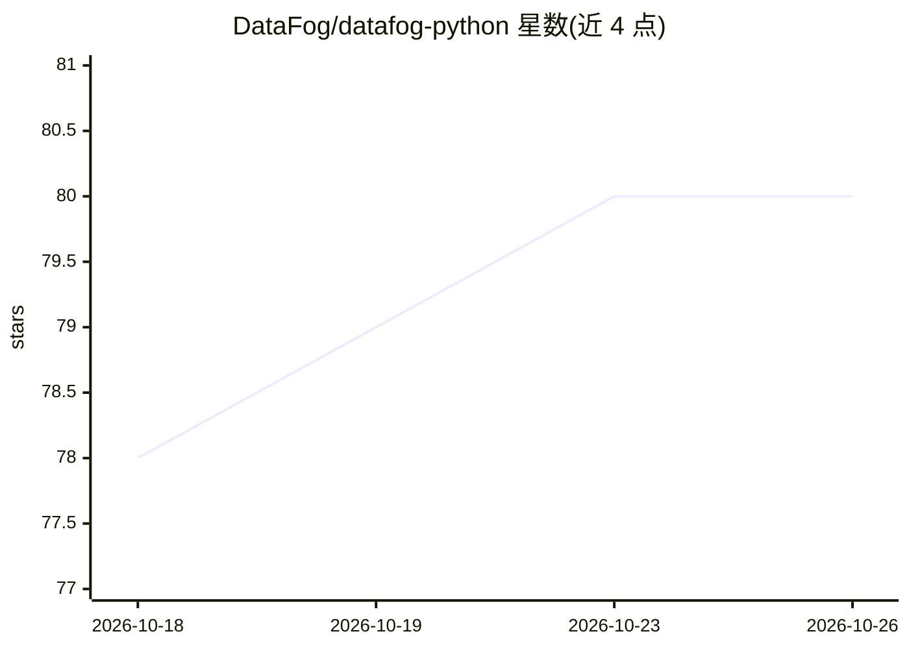

# DataFog/datafog-python

⭐ 80 · Python · MIT · 推送 2026-10-24 · [GitHub](https://github.com/DataFog/datafog-python) · [官网](https://datafog.ai) · 组织维护

**面向 AI 应用的离线 PII 检测与脱敏 Python 库**

Python 库，通过 regex 引擎检测并脱敏个人身份信息（邮箱/电话/SSN/信用卡等），可选 spaCy/GLiNER NER 引擎处理非结构化实体，支持德语结构化 ID。提供两个执行点：Claude Code hook 拦截 agent 工具调用中的 PII，LiteLLM 网关 guardrail 对任意代理供应商的请求/响应做脱敏或阻断。零网络调用，核心安装仅一条依赖；提供 CLI 与向后兼容 API。OCR 与 Spark 面为可选且在 4.9 中已标记废弃、5.0 将移除。

## 筛选速览

| 维度 | 判定 | 备注 |
|---|---|---|
| AI 角色 | `ai-ecosystem` | LLM/agent 周边工具 |
| 许可风险 | `permissive` | MIT |
| 部署形态 | `library` | 以包/库形式分发 |
| 模型依赖 | — | README 未给出锁定关系 |
| 硬件要求 | — | 无带数字的原话,不猜 |
| 安装摩擦 | `low` | 无编译、无系统依赖或容器化 |
| 成熟度 | — | 结构信号不足 |

## 能力要点

- regex 引擎离线检测 EMAIL/PHONE/SSN/CREDIT_CARD 等实体
- Claude Code hook 拦截工具调用中的 PII（约 70–90ms/次）
- LiteLLM 网关 guardrail，进程内扫描（约 40µs/条消息）
- allowlist 精确值与正则豁免机制

## 适用场景

- LLM 应用发送提示词前扫描并脱敏 PII
- Claude Code agent 工具调用时拦截含 PII 的命令与结果
- LiteLLM 网关层对多供应商请求做统一 PII 防护
- 合规场景下对结构化 PII 做确定性检测

## 场景标签

`网络安全` · 领域:学习与行业

## 证据(README 行号)

> L8: - An offline PII firewall for AI agents: a Claude Code hook and a LiteLLM
> L33: - **LiteLLM guardrail** (`DataFogGuardrail`): redacts or blocks PII in
> L88: # 1) Scan prompt text before sending to an LLM

## 星数曲线

2026-10-18 78 → 2026-10-26 80（+2）

---
*卡片 v1 · prompt 1.4 · 生成 2026-10-24 · 置信度 high · 依据 README sha `effa0d2244c7` · [字段定义](../../DATASET.md)*
