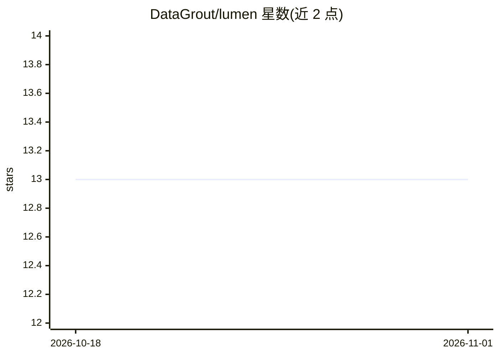

# DataGrout/lumen

⭐ 13 · Rust · MIT · 推送 2026-10-13 · [GitHub](https://github.com/DataGrout/lumen) · [官网](https://datagrout.ai/lumen) · 组织维护

**给 LLM 用户的实时用量与成本监控器（代理/中继截流）**

由 DataGrout 维护的本地 LLM 流量监控工具：Rust 守护进程 lumen-core 以 HTTP 正向代理（:9090，TLS MITM 需信任本地 CA）或 relay 中继两种方式截获 LLM API 调用，解析 token 用量与成本元数据，通过 JSON API（:9091）供 macOS 原生菜单栏 SwiftUI 应用或跨平台浏览器仪表盘展示实时仪表、事件流与 lap 会话分界。内置 OpenAI/Anthropic/Cursor/Google AI 端点，可自定义主机。默认仅采集 token 计数与定价元数据，不存储消息内容。macOS 14+ 提供原生应用，Linux/Windows 仅守护进程加浏览器界面，需从源码用 cargo 构建。

## 筛选速览

| 维度 | 判定 | 备注 |
|---|---|---|
| AI 角色 | `ai-ecosystem` | LLM/agent 周边工具 |
| 许可风险 | `permissive` | MIT |
| 部署形态 | `desktop` | 安装包/桌面程序 |
| 模型依赖 | locked-api |  |
| 硬件要求 | — | 无带数字的原话,不猜 |
| 安装摩擦 | `medium` | 含编译或系统依赖之一 |
| 成熟度 | — | 结构信号不足 |

## 能力要点

- 代理（TLS MITM）与 relay 两种截流模式，relay 无需安装 CA
- 实时仪表：lap 成本、token 速率、总支出，含输入/输出与缓存命中分解
- 内置 OpenAI/Anthropic/Cursor/Google AI 端点，支持自定义主机（本地模型、OpenAI 兼容 API、MCP 服务器）
- 默认不存储消息内容，仅采集 token 计数与定价元数据

## 适用场景

- 在菜单栏实时查看我使用 Claude Code / Cursor 等 LLM 工具的花费和 token 速率
- 按会话（lap）对比前后成本
- 监控自托管模型或 OpenAI 兼容端点的用量
- 团队通过 DataGrout 服务器同步用量事件做报表

## 场景标签

`LLM 可观测性` · 领域:评测与运维

## 证据(README 行号)

> L9: Lumen intercepts LLM API traffic, extracts token usage and cost metadata, and displays it in a live gauge interface 
> L22: - **lumen-core** -- Rust binary. Runs an HTTP forward proxy on `:9090` that intercepts LLM API calls, parses token 
> L30: - **Event feed** -- Scrollable log of every API call with model, tokens, and cost

## 星数曲线

2026-10-18 13 → 2026-11-01 13（+0）

---
*卡片 v1 · prompt 1.4 · 生成 2026-10-31 · 置信度 high · 依据 README sha `8d5fe1c6dd64` · [字段定义](../../DATASET.md)*
