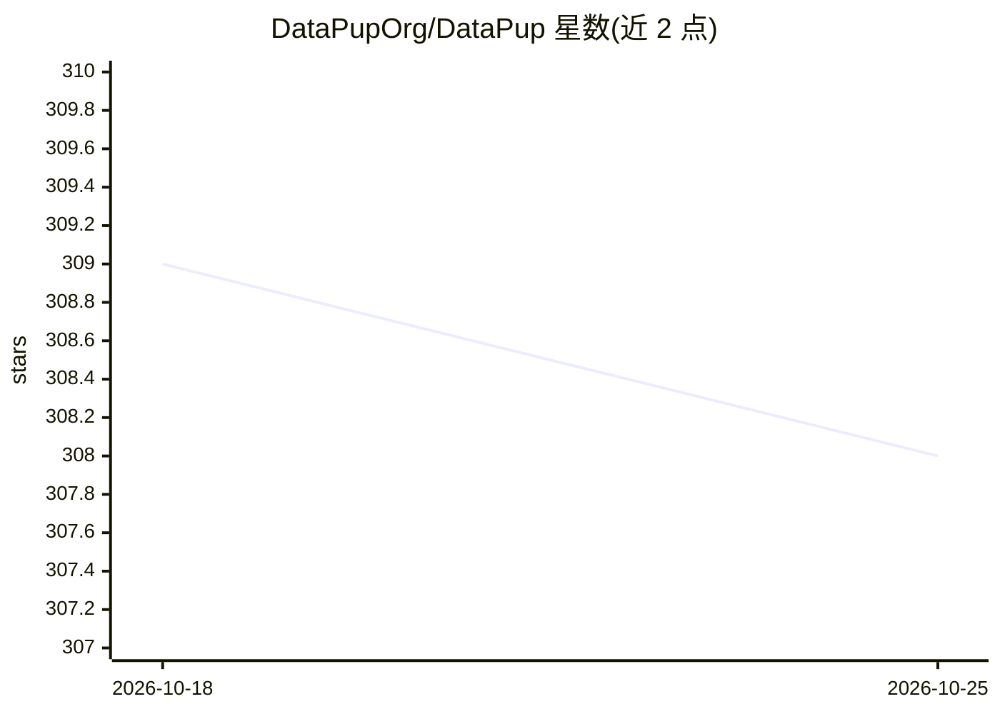

# DataPupOrg/DataPup

⭐ 308 · TypeScript · MIT · 推送 2026-02-09 · [GitHub](https://github.com/DataPupOrg/DataPup) · 组织维护

**带 AI 查询辅助的跨平台开源数据库客户端**

基于 Electron 的开源桌面数据库客户端，面向开发者提供数据库管理界面与 AI 驱动的查询辅助功能。当前支持 ClickHouse（含优化查询执行）与 PostgreSQL；MySQL/MariaDB 与 SQLite 标注为约两周内可用。开发需 Node.js 18+ 与 npm/yarn/pnpm，提供 npm install、npm run dev/build/dist 的源码构建流程，MIT 许可并欢迎 PR。

## 筛选速览

| 维度 | 判定 | 备注 |
|---|---|---|
| AI 角色 | `ai-enhanced` | 去掉 AI 部分产品仍成立 |
| 许可风险 | `permissive` | MIT |
| 部署形态 | `library` | 以包/库形式分发 |
| 模型依赖 | — | README 未给出锁定关系 |
| 硬件要求 | — | 无带数字的原话,不猜 |
| 安装摩擦 | `low` | 无编译、无系统依赖或容器化 |
| 成熟度 | — | 结构信号不足 |

## 能力要点

- ClickHouse 与 PostgreSQL 已支持，MySQL/MariaDB 与 SQLite 列入近期计划
- AI 驱动的查询辅助功能
- Electron 跨平台桌面应用，MIT 开源

## 适用场景

- 在桌面图形界面中连接并管理 ClickHouse/PostgreSQL
- 借助 AI 辅助编写数据库查询
- 本地开发测试时使用（SQLite 支持列入计划）

## 场景标签

`数据分析` · 领域:效率与自动化

## 证据(README 行号)

> L5: > A modern, AI-assisted, cross-platform database client.
> L12: DataPup is an open-source database client designed to make database management intuitive and enjoyable. With AI-pow

## 星数曲线

2026-10-18 309 → 2026-10-25 308（-1）

---
*卡片 v1 · prompt 1.4 · 生成 2026-10-21 · 置信度 high · 依据 README sha `d48cecea2f2d` · [字段定义](../../DATASET.md)*
