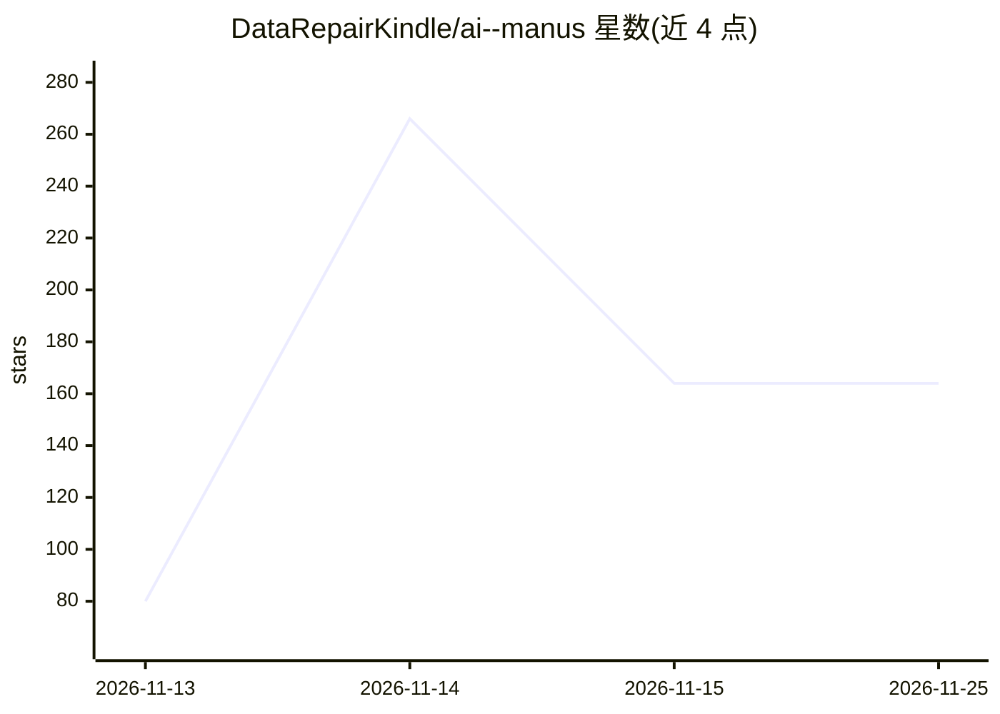

# DataRepairKindle/ai--manus

⭐ 164 · Apache-2.0 · 推送 2026-11-15 · [GitHub](https://github.com/DataRepairKindle/ai--manus) · 组织维护

**自主执行代码与浏览器操作的通用 AI Agent 助手**

面向家庭、学习与轻量办公场景的自主 AI agent：用户以自然语言描述需求，agent 自行编写并执行脚本、打开网页、与页面元素交互、完成多步任务，脚本与浏览器操作可在同一流程内衔接；支持跨会话记住任务模式。README 提供最低配置表（双核 CPU / 4GB 内存）与六步上手指南，但未给出具体安装命令、下载渠道或模型接入方式，代码执行运行于沙箱环境的说明来自仓库描述。

## 筛选速览

| 维度 | 判定 | 备注 |
|---|---|---|
| AI 角色 | `ai-native` | 本体是模型或模型工具 |
| 许可风险 | `permissive` | Apache-2.0 |
| 部署形态 | `None` |  |
| 模型依赖 | — | README 未给出锁定关系 |
| 硬件要求 | — | 无带数字的原话,不猜 |
| 安装摩擦 | `low` | 无编译、无系统依赖或容器化 |
| 成熟度 | — | 结构信号不足 |

## 能力要点

- 自主编写并执行代码完成任务
- 浏览器控制：导航网页、填表、抓取信息
- 代码与浏览器操作可在同一工作流中衔接
- 面向小规模场景：学习、家庭与轻办公任务

## 适用场景

- 让学生收集参考资料、运行小脚本、整理笔记
- 让 agent 代为检查网页更新、填写重复表单
- 开发时快速运行试验并比较结果

## 场景标签

`编码 Agent` `浏览器自动化` `AI 助手` · 领域:效率与自动化

## 证据(README 行号)

> L18: Manus is an autonomous AI agent designed to run code and control a browser on your behalf. Instead of acting like a
> L10: - **Autonomous Code Execution:** Manus AI agent runs code on its own to complete tasks, so you can focus on decisio

## 星数曲线

2026-11-13 80 → 2026-11-25 164（+84）

---
*卡片 v1 · prompt 1.4 · 生成 2026-11-17 · 置信度 mid · 依据 README sha `0f78ee3a5dd2` · [字段定义](../../DATASET.md)*
