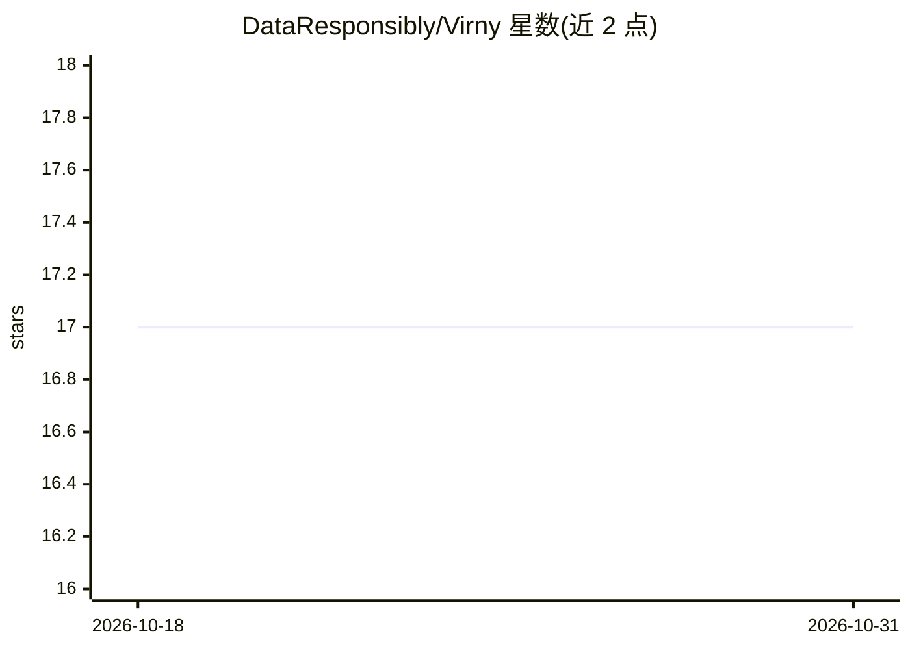

# DataResponsibly/Virny

⭐ 17 · Python · BSD-3-Clause · 推送 2026-05-06 · [GitHub](https://github.com/DataResponsibly/Virny) · 组织维护

**机器学习模型性能剖析库：多维评估公平性/稳定性/不确定性**

面向数据科学家的 Python 库，对一组已初始化模型做整体与子群级别的性能剖析，覆盖 accuracy、稳定性、不确定性与公平性维度；支持非二元敏感属性及其交集分析，兼容 AIF360 的公平性预/中/后处理器与 PyTorch Tabular，结果可保存至用户数据库。配套交互工具 VirnyView 用于生成模型营养标签与多模型对比，辅助负责任的模型选择。模型审计解耦为子群指标计算、差异指标组合与可视化三阶段，可服务于模型开发与部署后监控。需 Python 3.9-3.12。

## 筛选速览

| 维度 | 判定 | 备注 |
|---|---|---|
| AI 角色 | `ai-ecosystem` | LLM/agent 周边工具 |
| 许可风险 | `permissive` | BSD-3-Clause |
| 部署形态 | `library` | 以包/库形式分发 |
| 模型依赖 | — | README 未给出锁定关系 |
| 硬件要求 | — | 无带数字的原话,不猜 |
| 安装摩擦 | `low` | 无编译、无系统依赖或容器化 |
| 成熟度 | — | 结构信号不足 |

## 能力要点

- 按子群计算 accuracy/稳定性/不确定性/公平性指标
- 支持非二元敏感属性及其交集的公平性分析
- 交互式 VirnyView：营养标签生成与多模型对比选择
- 兼容 AIF360 公平性处理器与 PyTorch Tabular 集成

## 适用场景

- 模型上线前按敏感子群体审计性能差异
- 多模型对比并生成模型营养标签辅助选型
- 部署后持续监控模型稳定性与不确定性

## 场景标签

`模型评测` · 领域:评测与运维

## 证据(README 行号)

> L31: **Virny** is a Python library for in-depth profiling of model performance across overall and disparity dimensions.
> L43: Virny decouples model auditing into several stages, including: **subgroup metric computation**, **disparity metric 

## 星数曲线

2026-10-18 17 → 2026-10-31 17（+0）

---
*卡片 v1 · prompt 1.4 · 生成 2026-10-30 · 置信度 high · 依据 README sha `8c764da20a3c` · [字段定义](../../DATASET.md)*
