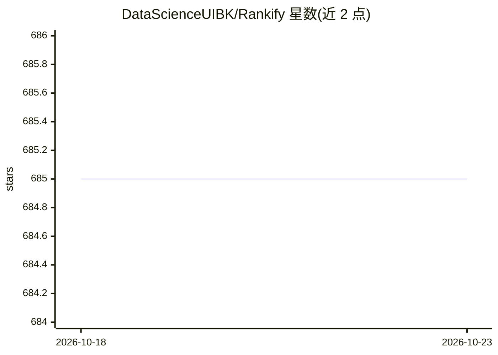

# DataScienceUIBK/Rankify

⭐ 685 · Python · 推送 2026-09-07 · [GitHub](https://github.com/DataScienceUIBK/Rankify) · [官网](https://rankify.readthedocs.io/) · 组织维护

**检索、重排序与 RAG 的 Python 工具包，面向研究评测与开发**

Rankify 是模块化的检索/重排序/RAG 框架：支持 7 种以上检索技术（BM25、DPR、ANCE、Contriever、ColBERT、BGE 及多种稠密 bi-encoder）、24 种以上重排序模型和多种 RAG 方法，内置 40 个预检索基准数据集（每个含 1000 篇文档）。提供 HuggingFace 风格的一行式 pipeline、rankify-index CLI 索引构建、REST API 部署、Gradio 交互界面与 LangChain/LlamaIndex 集成。RAG 生成模块支持 HuggingFace、OpenAI、LiteLLM、vLLM 后端。需 Python 3.10，推荐 PyTorch 2.5.1，评测指标针对 GPU 优化。配套论文发表于 arXiv。

## 筛选速览

| 维度 | 判定 | 备注 |
|---|---|---|
| AI 角色 | `ai-ecosystem` | LLM/agent 周边工具 |
| 许可风险 | `none` | — |
| 部署形态 | `library` | 以包/库形式分发 |
| 模型依赖 | local-ok | 支持本地模型 |
| 硬件要求 | — | 无带数字的原话,不猜 |
| 安装摩擦 | `high` | 编译与系统依赖俱全 |
| 成熟度 | — | 结构信号不足 |

## 能力要点

- 7 种以上检索技术与 24 种以上重排序模型的统一接口
- 40 个预检索基准数据集（每个含 1000 篇文档）
- pipeline 一行式 API 与 rankify serve REST API 部署
- RAG Generator 支持 HuggingFace/OpenAI/LiteLLM/vLLM 后端

## 适用场景

- 在统一框架下对比不同检索器与重排序模型的效果
- 构建检索-重排-生成的完整 RAG 流水线
- 在 40 个基准数据集上复现检索评测实验
- 把检索/重排能力以 REST API 形式部署或接入 LangChain/LlamaIndex

## 场景标签

`RAG` `模型评测` `语义搜索` · 领域:评测与运维

## 证据(README 行号)

> L36: _A modular and efficient retrieval, reranking and RAG framework designed to work with state-of-the-art models for r
> L406: Rankify provides a **Generator Module** for **retrieval-augmented generation (RAG)**, integrating retrieved docume

## 星数曲线

2026-10-18 685 → 2026-10-23 685（+0）

---
*卡片 v1 · prompt 1.4 · 生成 2026-10-21 · 置信度 high · 依据 README sha `a32a2d9a3988` · [字段定义](../../DATASET.md)*
