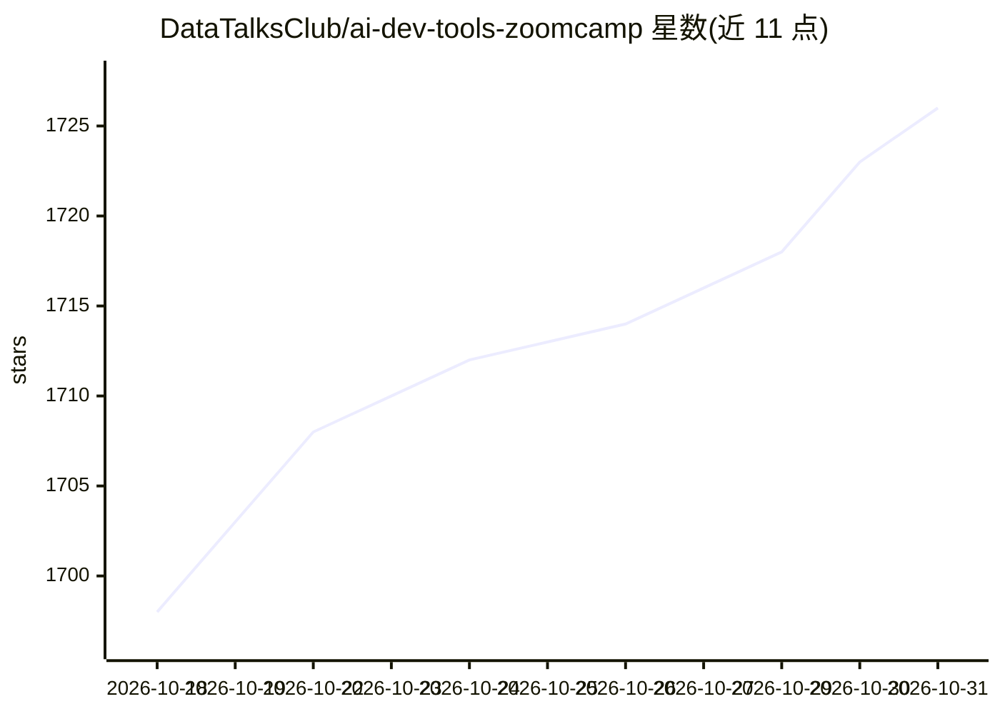

# DataTalksClub/ai-dev-tools-zoomcamp

⭐ 1,726 · Python · 推送 2026-10-26 · [GitHub](https://github.com/DataTalksClub/ai-dev-tools-zoomcamp) · [官网](https://courses.datatalks.club/register/ai-dev-tools/) · 组织维护

**面向开发者的免费课程：AI 编码工具的规范化软件开发流程**

DataTalksClub 组织的免费实战课程（2026 期 8 月 31 日开课），面向会写基础代码的开发者与数据从业者，讲授用 AI 编码助手、agent 与 MCP 进行软件构建、测试、部署、扩展与审计。核心流程是：给 AI 工具正确上下文、审查产出、测试结果并在护栏下交付。5 个模块覆盖 AI-native 开发工作流、全栈应用构建、容器化部署与 CI/CD、可观测性与 DevOps、可复用技能与子 agent，最终项目经同伴评审可获证书。可跟直播班或自学，无需 AI 工具经验与 GPU。

## 筛选速览

| 维度 | 判定 | 备注 |
|---|---|---|
| AI 角色 | `ai-knowledge` | 知识聚合/清单类 |
| 许可风险 | `none` | — |
| 部署形态 | `self-host` | docker 或自建部署 |
| 模型依赖 | — | README 未给出锁定关系 |
| 硬件要求 | — | 无带数字的原话,不猜 |
| 安装摩擦 | `low` | 无编译、无系统依赖或容器化 |
| 成熟度 | — | 结构信号不足 |

## 能力要点

- 5 个模块：从 AI-native 工作流到可观测性与可复用 agent 技能
- 构建并部署带测试与 CI/CD 的全栈应用
- 直播班含评分作业、同伴评审与证书；自学免费无证书
- 明确排除模型训练、微调、LangChain、向量库与 RAG 内容

## 适用场景

- 系统学习用编码 agent 做规范化的开发、测试与部署
- 通过最终项目建立 AI 辅助开发的实践作品集
- 给团队引入 AI 编码工具时参考可复现的工作流程

## 场景标签

`教程课程` · 领域:学习与行业

## 证据(README 行号)

> L5:  A free, hands-on course on using AI developer tools to build, test, deploy, extend, and audit software without losi
> L36: AI Dev Tools Zoomcamp is a free, practical course for developers and technical data professionals who want to learn
> L42: You will compare modern AI developer tools, build and deploy a full-stack application, operate it with observabilit

## 星数曲线

2026-10-18 1,698 → 2026-10-31 1,726（+28）

---
*卡片 v1 · prompt 1.4 · 生成 2026-10-21 · 置信度 mid · 依据 README sha `d5ae48336c47` · [字段定义](../../DATASET.md)*
