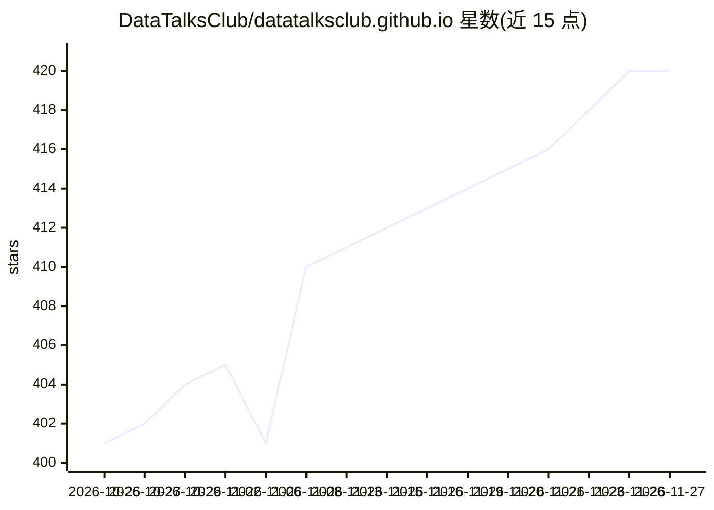

# DataTalksClub/datatalksclub.github.io

⭐ 420 · Python · 推送 2026-11-25 · [GitHub](https://github.com/DataTalksClub/datatalksclub.github.io) · [官网](https://datatalks.club) · 组织维护

**数据科学社区 DataTalks.Club 的静态网站源码仓库**

datatalks.club 社区网站的静态站点源码与内容仓库：以 markdown 集合（_posts、_podcast、_books、_people 等）组织文章、播客、书籍、人物、课程与活动，用 Liquid 模板和 _data YAML 管理导航、活动、赞助商，由 Rustkyll 生成静态页面，make serve 本地运行，附带 uv/npm 脚本从模板创建内容、从 DOCX 生成文章草稿。面向数据科学与机器学习从业者的社区贡献者。仓库声明新内容已迁至新站点，此处仅保留旧静态站。

## 筛选速览

| 维度 | 判定 | 备注 |
|---|---|---|
| AI 角色 | `ai-knowledge` | 知识聚合/清单类 |
| 许可风险 | `none` | — |
| 部署形态 | `library` | 以包/库形式分发 |
| 模型依赖 | — | README 未给出锁定关系 |
| 硬件要求 | — | 无带数字的原话,不猜 |
| 安装摩擦 | `medium` | 含编译或系统依赖之一 |
| 成熟度 | — | 结构信号不足 |

## 能力要点

- 集合化内容模型：文章、播客、书籍、人物、活动各设独立集合与 permalink
- 导航、活动、赞助商由 _data YAML 数据驱动
- make install/make serve 本地构建与开发服务器
- 辅助脚本支持模板化创建内容与 DOCX 转文章草稿

## 适用场景

- 为社区网站投稿文章或播客节目页
- 维护社区活动日历与人物档案
- 本地构建预览站点页面改动

## 场景标签

`教程课程` · 领域:学习与行业

## 证据(README 行号)

> L9: This repository contains the source code and content for datatalks.club, a Rustkyll-built community website for data
> L13: - Static website built with Rustkyll

## 星数曲线

2026-10-25 401 → 2026-11-27 420（+19）

---
*卡片 v1 · prompt 1.4 · 生成 2026-11-26 · 置信度 mid · 依据 README sha `edbf473a797b` · [字段定义](../../DATASET.md)*
