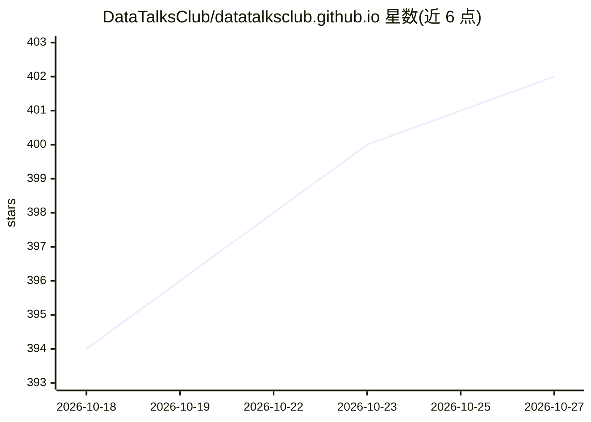

# DataTalksClub/datatalksclub.github.io

⭐ 402 · Python · 推送 2026-10-16 · [GitHub](https://github.com/DataTalksClub/datatalksclub.github.io) · [官网](https://datatalks.club) · 组织维护

**DataTalks.Club 社区官网源码：数据/AI 从业者的内容站点**

用 Rustkyll 构建的静态社区网站源码与内容仓库，服务于数据科学、机器学习、AI 与数据工程从业者。内容以 Markdown 与数据文件组织为 collections（文章、播客、书籍、人物、课程、工具、会议），导航、活动与赞助商由 _data 下的 YAML 管理，页面用 Liquid 模板渲染。本地开发需 Rustkyll 发布二进制（make install）与 uv，提供 make serve 启动开发服务器，并带交互式内容创建与 DOCX 转文章的 Python 辅助脚本。

## 筛选速览

| 维度 | 判定 | 备注 |
|---|---|---|
| AI 角色 | `ai-knowledge` | 知识聚合/清单类 |
| 许可风险 | `none` | — |
| 部署形态 | `library` | 以包/库形式分发 |
| 模型依赖 | — | README 未给出锁定关系 |
| 硬件要求 | — | 无带数字的原话,不猜 |
| 安装摩擦 | `medium` | 含编译或系统依赖之一 |
| 成熟度 | — | 结构信号不足 |

## 能力要点

- 7 类 collections（posts/podcast/books/people/courses/tools/conferences）+ YAML 数据驱动的站点结构
- Rustkyll 构建，Liquid 模板与自定义 permalink 规则
- scripts/create.py 交互式创建人物/书籍/活动，pandoc 脚本从 DOCX 生成文章草稿
- make serve 本地开发服务器（localhost:4000）

## 适用场景

- 为 DataTalks.Club 社区贡献文章、播客或活动内容
- 维护社区人物目录、赞助商与导航等站点数据
- 了解以 collections + YAML 数据文件组织的静态站架构

## 场景标签

 · 领域:数据科学社区/网站

## 证据(README 行号)

> L3: This repository contains the source code and content for datatalks.club, a Rustkyll-built community website for data
> L9: - Main entities are modeled as collections (`_posts`, `_podcast`, `_books`, `_people`, etc.)

## 星数曲线

2026-10-18 394 → 2026-10-27 402（+8）

---
*卡片 v1 · prompt 1.4 · 生成 2026-10-21 · 置信度 low · 依据 README sha `83b8f7a0fb04` · [字段定义](../../DATASET.md)*
