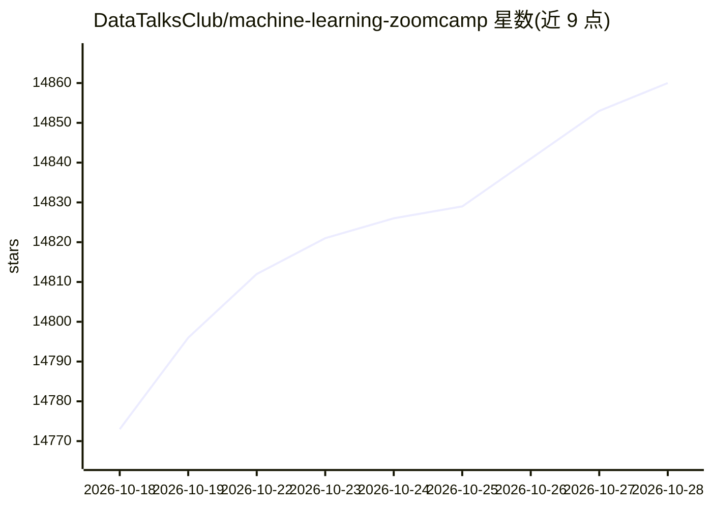

# DataTalksClub/machine-learning-zoomcamp

⭐ 14,873 · Jupyter Notebook · 推送 2026-10-26 · [GitHub](https://github.com/DataTalksClub/machine-learning-zoomcamp) · [官网](https://courses.datatalks.club/register/ml-zoomcamp/) · 组织维护

**面向工程师的免费 4 个月机器学习工程实战课程**

DataTalks.Club 出品的免费机器学习工程课程，覆盖从问题定义、数据准备、模型训练评估到通过 API 部署上线的完整流程。技术栈包括 Python、scikit-learn、TensorFlow、PyTorch、FastAPI、Docker、Kubernetes 与 AWS Lambda。支持随直播批次学习（含作业评分、同伴评审、证书资格）或按材料自学（免费但不评分、无证书）。前置要求为至少一年编程经验，不要求 ML 经验或本地 GPU，深度学习模块使用云端资源。

## 筛选速览

| 维度 | 判定 | 备注 |
|---|---|---|
| AI 角色 | `ai-knowledge` | 知识聚合/清单类 |
| 许可风险 | `none` | — |
| 部署形态 | `None` |  |
| 模型依赖 | — | README 未给出锁定关系 |
| 硬件要求 | — | 无带数字的原话,不猜 |
| 安装摩擦 | `low` | 无编译、无系统依赖或容器化 |
| 成熟度 | — | 结构信号不足 |

## 动量与使用信号

- 维护:`active` — 距上次 push 1.7 天,年发版 0,135 位贡献者
- 涨星:近 1 天 **+11**(自 20261016 起算)
- 下载:GitHub Release 附件 累计 7,872(2 个 release)

## 能力要点

- 10 个模块 + 期中与两个 capstone 项目的完整课程结构
- 覆盖模型训练到 FastAPI/Docker/Kubernetes/AWS Lambda 部署全链路
- 支持直播批次（证书/评审/排行榜）与自学两种参与方式
- 深度学习模块使用云端资源，不要求本地 GPU

## 适用场景

- 有编程经验想转入机器学习工程方向
- 系统学习模型从开发到生产部署的完整流程
- 积累可放进作品集的端到端 ML 项目
- 自学模式下免费使用全部课程材料

## 场景标签

`教程课程` · 领域:学习与行业

## 证据(README 行号)

> L34: Machine Learning Zoomcamp is a free, practical course for people who want to learn machine learning engineering by 
> L40: You will work with Python, NumPy, pandas, scikit-learn, TensorFlow, PyTorch, FastAPI, Docker, Kubernetes, and AWS L
> L81: - A powerful computer or local GPU. The deep learning modules use cloud resources for more intensive computation.

## 星数曲线

2026-10-18 14,773 → 2026-10-28 14,860（+87）

---
*卡片 v1 · prompt 1.4 · 生成 2026-10-18 · 置信度 high · 依据 README sha `81c5e780ec5d` · [字段定义](../../DATASET.md)*
