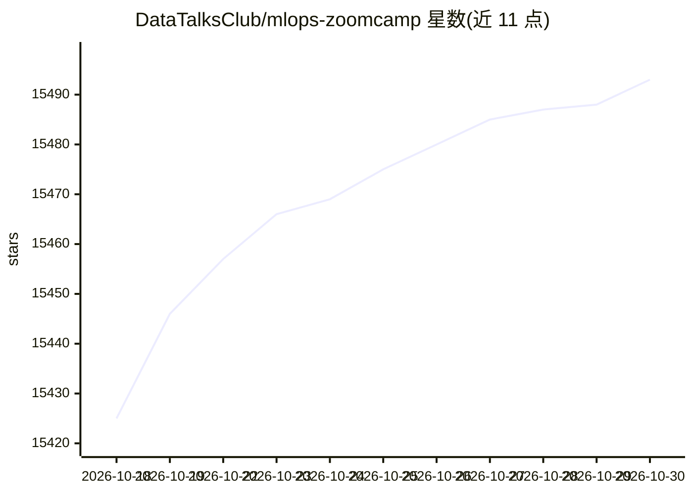

# DataTalksClub/mlops-zoomcamp

⭐ 15,493 · Jupyter Notebook · 推送 2026-10-15 · [GitHub](https://github.com/DataTalksClub/mlops-zoomcamp) · [官网](https://courses.datatalks.club/register/mlops-zoomcamp/) · 组织维护

**面向数据从业者的 9 周免费 MLOps 课程**

DataTalks.Club 出品的免费 9 周 MLOps 课程，内容覆盖实验跟踪（MLflow）、工作流编排、模型部署（Flask、AWS Kinesis/Lambda）、监控（Evidently、Grafana、Prometheus）及 CI/CD、Terraform 等最佳实践，以模块化课程、作业与期末项目组成。提供直播批次与自学两种形式，2026 年暂无直播批次，材料全部开放自学。面向有 Python、Docker 与一年以上编程经验的数据科学家、ML 工程师和软件工程师。

## 筛选速览

| 维度 | 判定 | 备注 |
|---|---|---|
| AI 角色 | `ai-knowledge` | 知识聚合/清单类 |
| 许可风险 | `none` | — |
| 部署形态 | `None` |  |
| 模型依赖 | — | README 未给出锁定关系 |
| 硬件要求 | — | 无带数字的原话,不猜 |
| 安装摩擦 | `low` | 无编译、无系统依赖或容器化 |
| 成熟度 | — | 结构信号不足 |

## 动量与使用信号

- 维护:`active` — 距上次 push 2.8 天,年发版 0,113 位贡献者
- 涨星:近 1 天 **+8**(自 20261016 起算)
- 安装:github 包 `release-assets` 月下载无数据

## 能力要点

- 9 个模块覆盖从实验跟踪到监控的 MLOps 全流程
- 完成期末项目与互评可获得结业证书
- 课程视频、材料、作业全部免费开放
- Slack 社区支持提问与学习打卡

## 适用场景

- 系统学习将机器学习模型部署到生产环境的方法
- 按模块自学 MLflow、编排、部署与监控工具链
- 通过期末项目搭建可放入作品集的端到端 MLOps 流水线

## 场景标签

`教程课程` `MLOps` · 领域:学习与行业

## 证据(README 行号)

> L28: MLOps (machine learning operations) is a must-know skill for many data professionals. This free 9-week course teach
> L32: This course is for data scientists, ML engineers, and software engineers who want to learn how to put machine learn

## 星数曲线

2026-10-18 15,425 → 2026-10-30 15,493（+68）

---
*卡片 v1 · prompt 1.4 · 生成 2026-10-18 · 置信度 high · 依据 README sha `669d4b42ed28` · [字段定义](../../DATASET.md)*
