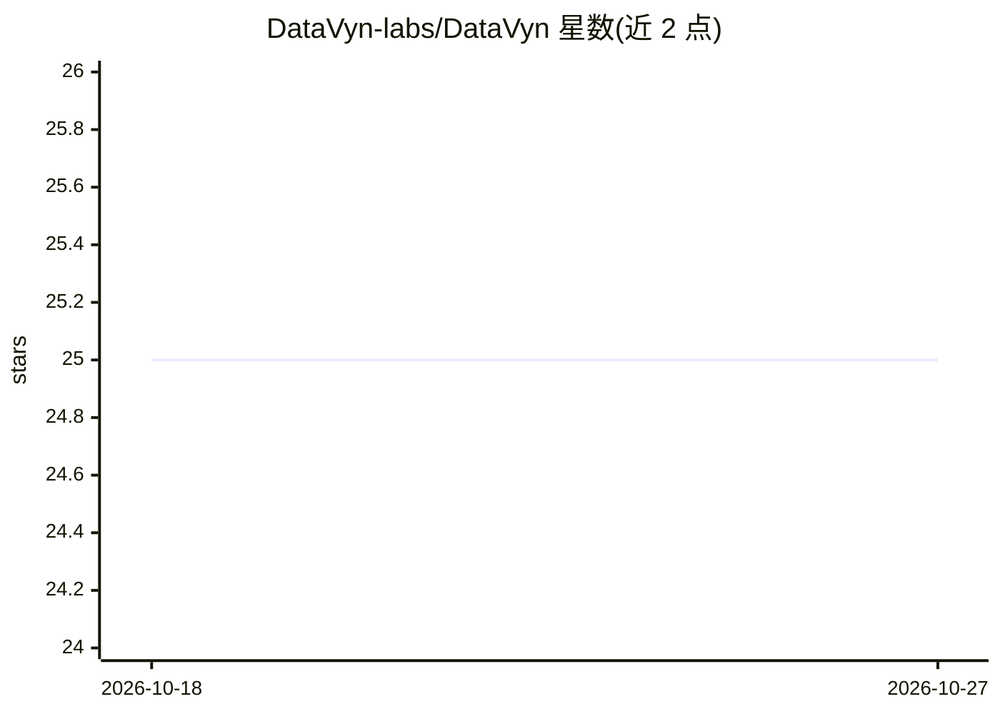

# DataVyn-labs/DataVyn

⭐ 25 · Python · MIT · 推送 2026-04-15 · [GitHub](https://github.com/DataVyn-labs/DataVyn) · [官网](https://datavyn.streamlit.app/) · 组织维护

**面向数据分析师的 Streamlit 数据分析平台：上传数据生成图表与 AI 洞察**

基于 Streamlit 的数据智能平台：支持上传 CSV/TSV/JSON/Excel/Parquet 文件，自动生成直方图、散点图、热力图等图表；可连接 SQLite/PostgreSQL/MySQL 数据库，并通过 Kaggle API 搜索下载数据集。AI 部分由 Claude（Anthropic API）驱动，提供 5 种分析模式生成洞察，可导出为含统计表与 AI 洞察的 PDF 报告。需在侧边栏配置 Anthropic API key，Kaggle 功能需单独的 API token。

## 筛选速览

| 维度 | 判定 | 备注 |
|---|---|---|
| AI 角色 | `ai-enhanced` | 去掉 AI 部分产品仍成立 |
| 许可风险 | `permissive` | MIT |
| 部署形态 | `library` | 以包/库形式分发 |
| 模型依赖 | — | README 未给出锁定关系 |
| 硬件要求 | — | 无带数字的原话,不猜 |
| 安装摩擦 | `low` | 无编译、无系统依赖或容器化 |
| 成熟度 | — | 结构信号不足 |

## 能力要点

- 多格式数据上传（CSV/TSV/JSON/Excel/Parquet）与自动图表生成
- Claude（Anthropic API）驱动的 5 种 AI 分析模式
- 连接 SQLite/PostgreSQL/MySQL 数据库及 Chinook 示例库
- 含统计表与 AI 洞察的 PDF 报告导出

## 适用场景

- 上传数据集快速生成可视化图表与统计报告
- 通过 AI 分析模式从数据中获取文字洞察
- 直接搜索并下载 Kaggle 数据集进行分析

## 场景标签

`数据分析` · 领域:效率与自动化

## 证据(README 行号)

> L3: A production-grade Streamlit data intelligence platform.
> L36: |**AI Insights**|5 analysis modes powered by Claude (Anthropic API)|

## 星数曲线

2026-10-18 25 → 2026-10-27 25（+0）

---
*卡片 v1 · prompt 1.4 · 生成 2026-10-27 · 置信度 high · 依据 README sha `6d597c6222b6` · [字段定义](../../DATASET.md)*
