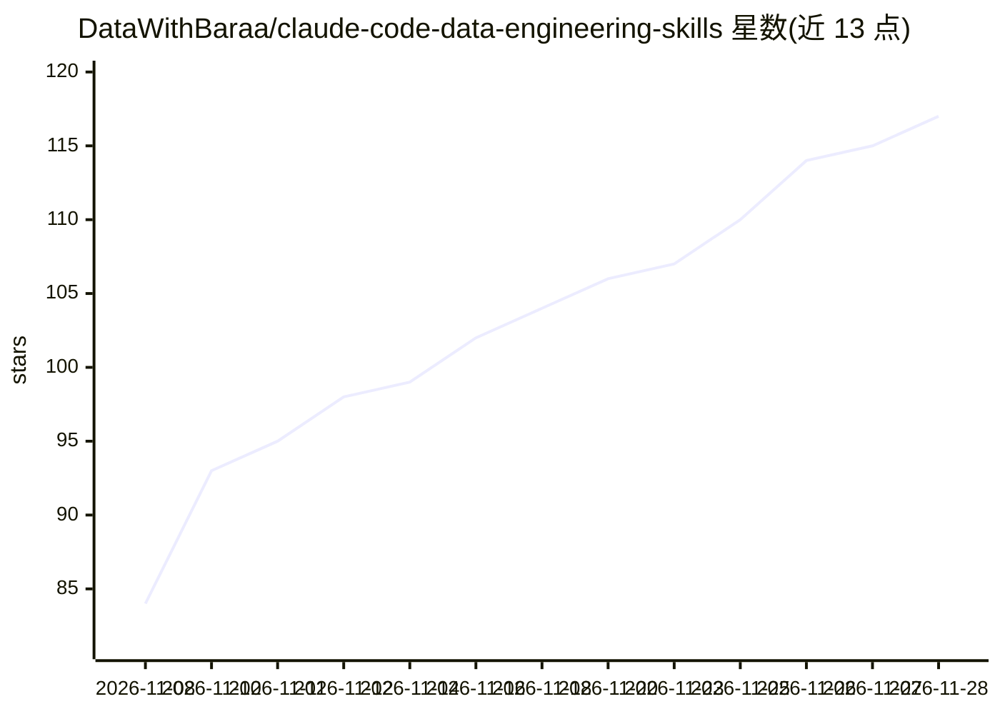

# DataWithBaraa/claude-code-data-engineering-skills

⭐ 117 · HTML · MIT · 推送 2026-11-06 · [GitHub](https://github.com/DataWithBaraa/claude-code-data-engineering-skills) · [官网](https://youtu.be/F5lZj1bQyUw) · 个人维护

**面向数据工程师的 16 个 Claude Code 技能包**

为 Claude Code 提供的 16 个数据工程技能（SKILL.md 格式），覆盖新数据源剖析、数据契约、元数据构建、故障根因调查、数据质量核查、变更影响分析、PR 审查、平台文档与成本审查等场景，多数技能最终生成可分享的网页。使用需 Claude Code 及 Claude Pro/Max/Team/Enterprise 或 Console 账户；通过 git clone 复制到项目 .claude/skills 或以插件方式安装，插件更新不自动。作者声明为第一版草稿，将持续扩展。

## 筛选速览

| 维度 | 判定 | 备注 |
|---|---|---|
| AI 角色 | `ai-knowledge` | 知识聚合/清单类 |
| 许可风险 | `permissive` | MIT |
| 部署形态 | `None` |  |
| 模型依赖 | — | README 未给出锁定关系 |
| 硬件要求 | — | 无带数字的原话,不猜 |
| 安装摩擦 | `low` | 无编译、无系统依赖或容器化 |
| 成熟度 | `idea` | |

## 能力要点

- 16 个 SKILL.md 格式技能，按数据源接入/故障处理/变更审查/文档等场景组织
- 多数技能输出可阅读分享的网页（源剖析、事故报告、数据产品页等）
- 支持 git clone 复制或 Claude Code 插件市场两种安装方式

## 适用场景

- 接入新数据源前生成剖析与数据契约页面
- 管道故障后调查根因并产出事故报告
- 变更合入前做影响分析与按标准的 PR 审查

## 场景标签

`代码审查` · 领域:编码与开发

## 证据(README 行号)

> L5: 16 Claude Code skills for the work of a data engineer beyond writing code: profiling a new source, investigating a f
> L78: Each skill is one `SKILL.md` with the job, the input, the steps, the output, what it reads, what it writes and what

## 星数曲线

2026-11-08 84 → 2026-11-28 117（+33）

---
*卡片 v1 · prompt 1.4 · 生成 2026-11-17 · 置信度 high · 依据 README sha `65931c47af17` · [字段定义](../../DATASET.md)*
