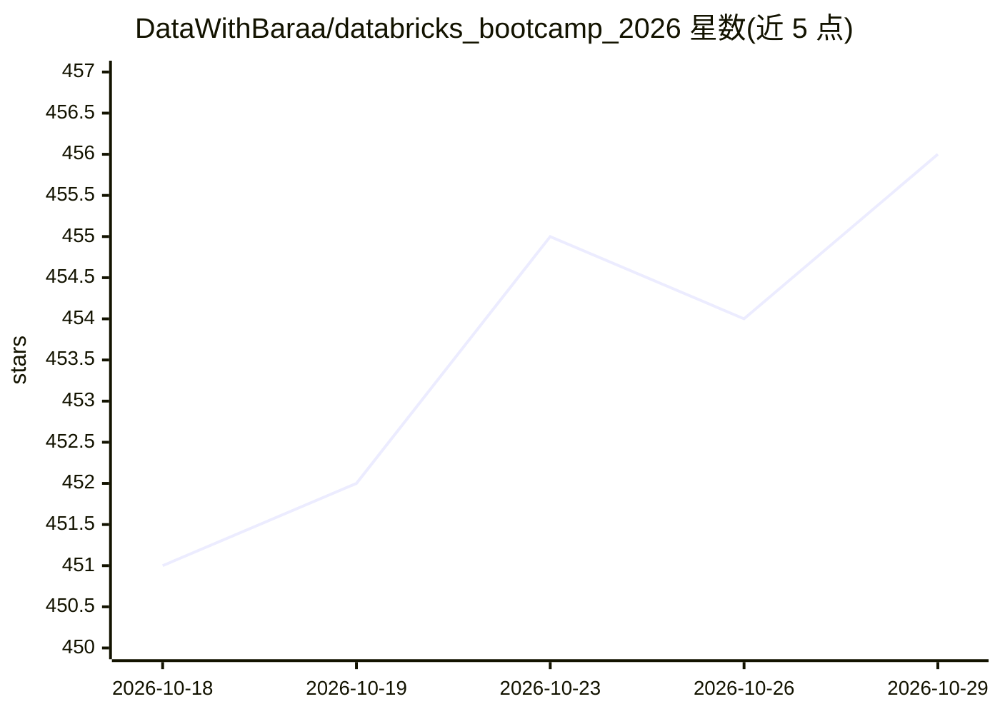

# DataWithBaraa/databricks_bootcamp_2026

⭐ 456 · Jupyter Notebook · MIT · 推送 2026-01-19 · [GitHub](https://github.com/DataWithBaraa/databricks_bootcamp_2026) · [官网](https://www.youtube.com/playlist?list=PLNcg_FV9n7qZoxVkw-KPhcmgLWjHWVUc9) · 个人维护

**Databricks 数据湖仓教学项目：Medallion 架构端到端实现参考**

面向学习者的数据湖仓实战仓库：在 Databricks 上按 Medallion 架构（Bronze 原始接入、Silver 清洗校验、Gold 维度建模）组织数据集、Notebook、SQL 示例与练习，覆盖数据摄入、转换到可分析数据产品的流程，技术栈含 Spark/PySpark/Spark SQL/Delta Lake/Unity Catalog。仓库要求学习者先按 Notion 路线图自行搭建，仅将本仓库作卡壳时的参考，配套 YouTube Bootcamp 视频讲解架构决策。前置仅需基础 SQL/Python/PySpark，无需 Databricks 经验。

## 筛选速览

| 维度 | 判定 | 备注 |
|---|---|---|
| AI 角色 | `ai-knowledge` | 知识聚合/清单类 |
| 许可风险 | `permissive` | MIT |
| 部署形态 | `None` |  |
| 模型依赖 | — | README 未给出锁定关系 |
| 硬件要求 | — | 无带数字的原话,不猜 |
| 安装摩擦 | `low` | 无编译、无系统依赖或容器化 |
| 成熟度 | — | 结构信号不足 |

## 能力要点

- Bronze/Silver/Gold 三层 Medallion 架构的完整数据工程流程
- 含数据集、Notebook、SQL 示例与练习
- 使用 Delta Lake 与 Unity Catalog 组织数据治理

## 适用场景

- 跟着 Bootcamp 学习 Databricks 数据工程并构建作品集
- 面试准备中参考真实的 Lakehouse 项目结构
- 卡壳时对照参考实现自查 Medallion 各层做法

## 场景标签

`教程课程` · 领域:学习与行业

## 证据(README 行号)

> L5: This repository contains a complete, real-world **Data Lakehouse implementation** built on Databricks, including dat
> L20: This project follows the **Medallion Architecture**:

## 星数曲线

2026-10-18 451 → 2026-10-29 456（+5）

---
*卡片 v1 · prompt 1.4 · 生成 2026-10-21 · 置信度 mid · 依据 README sha `2325edc2c2f4` · [字段定义](../../DATASET.md)*
