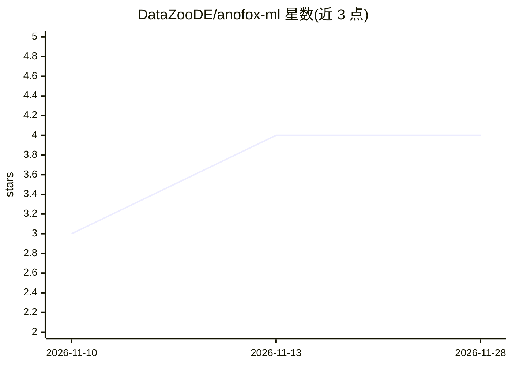

# DataZooDE/anofox-ml

⭐ 4 · Rust · NOASSERTION · 推送 2026-11-19 · [GitHub](https://github.com/DataZooDE/anofox-ml) · 组织维护

**让 DuckDB 用户在 SQL 中按组拟合 196 个 scikit-learn 兼容模型**

一个 DuckDB 扩展，把 anofox-ml Rust 库接入 SQL：提供 196 个经 scikit-learn 校验的估计器，覆盖监督学习、聚类、异常检测、降维与预处理。核心机制是 ml_fit_agg 聚合函数按 GROUP BY 分组拟合模型、以 BLOB 存储（MessagePack+zstd 版本化格式），后续查询用 ml_predict 系列函数预测。无 Python 运行时，组间并行拟合。通过 DuckDB 社区扩展仓库安装，支持 Linux/macOS/Windows 与 DuckDB-Wasm。README 声明处于早期开发阶段，API 可能变动。

## 筛选速览

| 维度 | 判定 | 备注 |
|---|---|---|
| AI 角色 | `ai-native` | 本体是模型或模型工具 |
| 许可风险 | `none` | NOASSERTION |
| 部署形态 | `library` | 以包/库形式分发 |
| 模型依赖 | — | README 未给出锁定关系 |
| 硬件要求 | — | 无带数字的原话,不猜 |
| 安装摩擦 | `medium` | 含编译或系统依赖之一 |
| 成熟度 | `idea` | |

## 能力要点

- 196 个 scikit-learn 兼容估计器，覆盖分类/回归/聚类/异常检测/降维/预处理
- 模型作为 BLOB 存储，可存表、join、写 Parquet，跨查询复用
- 按 GROUP BY 分组在所有核心上并行拟合模型
- 附 Claude Code 插件（四个 skill 教 LLM 生成正确的 SQL API 调用）

## 适用场景

- 在 SQL 中对每个门店/客户分组拟合并存储独立模型
- 在数据库内直接做聚类与异常评分，不导出数据
- 从 Python/R/Java 等语言通过 DuckDB 绑定调用库内机器学习

## 场景标签

 · 领域:数据库/机器学习基础设施

## 证据(README 行号)

> L14: A DuckDB extension that brings the anofox-ml Rust library into SQL: 196 scikit-learn-compatible estimators, checked
> L46: - **Native Rust core**: no Python runtime, no data copies out of the database

## 星数曲线

2026-11-10 3 → 2026-11-28 4（+1）

---
*卡片 v1 · prompt 1.4 · 生成 2026-11-21 · 置信度 high · 依据 README sha `12e35ca2304c` · [字段定义](../../DATASET.md)*
