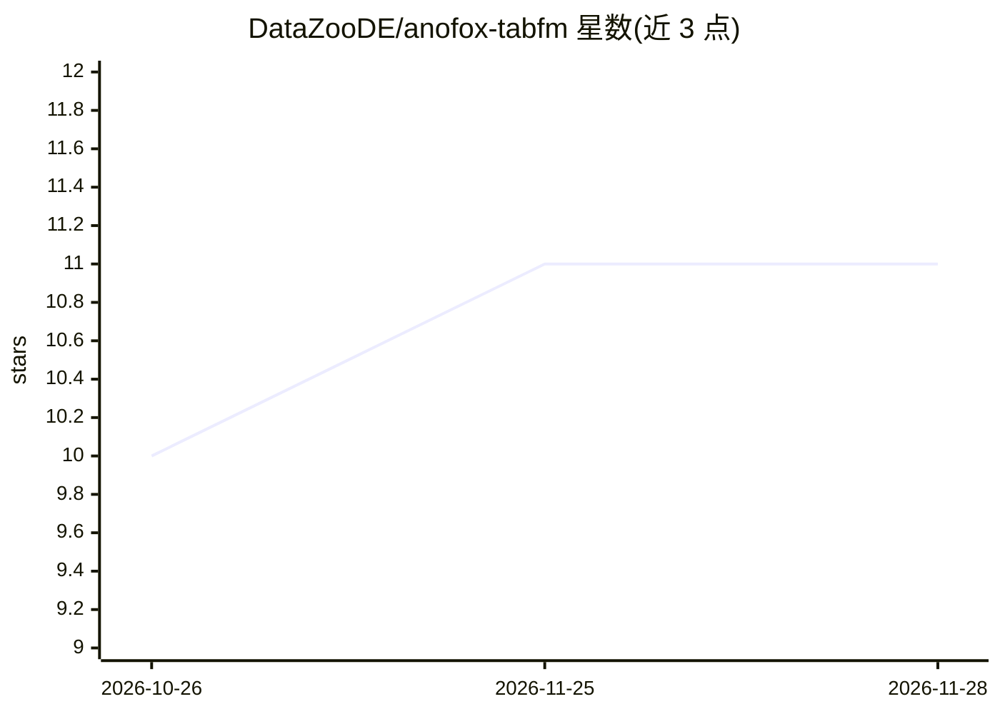

# DataZooDE/anofox-tabfm

⭐ 11 · C++ · MIT · 推送 2026-11-27 · [GitHub](https://github.com/DataZooDE/anofox-tabfm) · 组织维护

**在 DuckDB 中用 SQL 调用表格基础模型做零样本分类与回归**

一个 DuckDB 扩展，将表格基础模型（TabPFN 风格的 in-context learner）封装为 SQL 函数：tabfm_classify / tabfm_regress 以标注行为上下文预测其余行，无需 Python 或训练循环。内置 23 个可选模型（Mitra、TabPFN v2/3、TabICL v2、Google TabFM 等），支持 SQL 注册自有模型，另提供合成行生成、NULL 填充、交叉验证、指标聚合与绘图宏。权重不随扩展分发，需从 Hugging Face 下载；部分模型许可为非商业且需许可确认。CPU 支持 Linux/macOS/Windows，GPU 通过 tabfm_accelerate() 启用 CUDA/ROCm/MLX。

## 筛选速览

| 维度 | 判定 | 备注 |
|---|---|---|
| AI 角色 | `ai-native` | 本体是模型或模型工具 |
| 许可风险 | `permissive` | MIT |
| 部署形态 | `None` |  |
| 模型依赖 | — | README 未给出锁定关系 |
| 硬件要求 | — | 无带数字的原话,不猜 |
| 安装摩擦 | `high` | 编译与系统依赖俱全 |
| 成熟度 | — | 结构信号不足 |

## 能力要点

- 分类/回归一条 SQL 完成，模型按名称切换
- 内置 23 个模型，支持 SQL 注册自有模型
- 合成行生成 tabfm_generate 与 NULL 填充 tabfm_impute
- CPU 运行于 Linux/macOS/Windows，GPU 支持 CUDA/ROCm/MLX

## 适用场景

- 在数据库内对客户表做流失概率预测
- 用 SQL 对比多个表格模型在同一数据上的表现
- 为表格数据生成保持列间关系的合成行
- 填充表中缺失的目标列或 NULL 单元格

## 场景标签

`数据分析` `模型评测` · 领域:效率与自动化

## 证据(README 行号)

> L9: This extension runs **tabular foundation models**, TabPFN-style in-context learners, so classification
> L31: - **Classification and regression** in one call: `tabfm_classify`, `tabfm_regress`
> L53: - **CPU** on Linux, macOS (arm64) and Windows

## 星数曲线

2026-10-26 10 → 2026-11-28 11（+1）

---
*卡片 v1 · prompt 1.4 · 生成 2026-11-20 · 置信度 high · 依据 README sha `fea69a15ef0d` · [字段定义](../../DATASET.md)*
