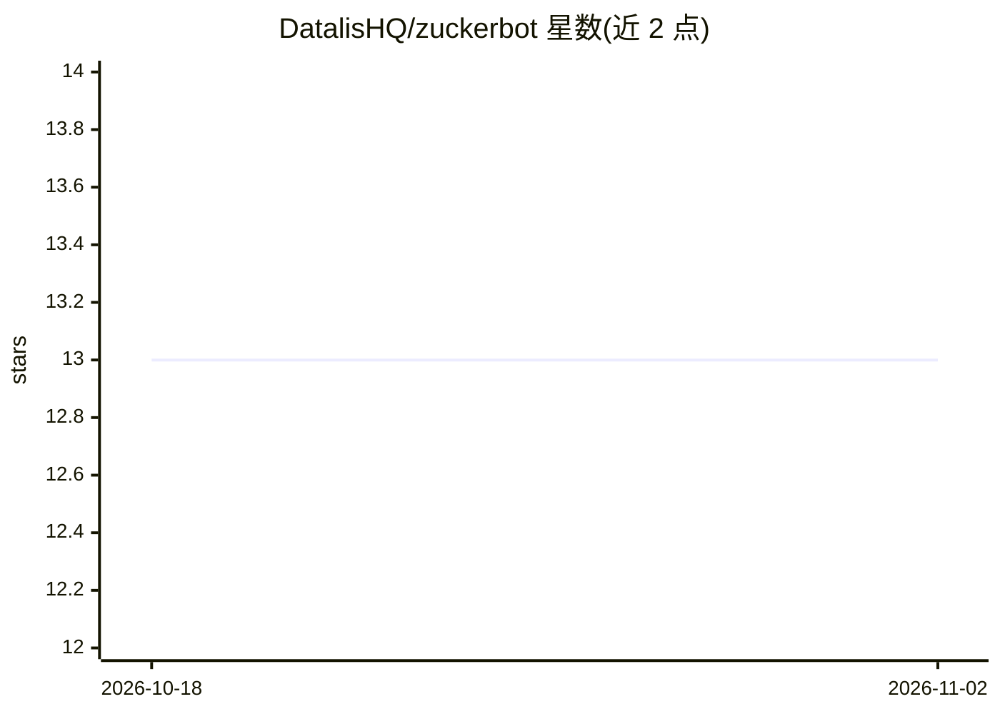

# DatalisHQ/zuckerbot

⭐ 13 · TypeScript · MIT · 推送 2026-09-16 · [GitHub](https://github.com/DatalisHQ/zuckerbot) · [官网](https://zuckerbot.ai) · 组织维护

**面向 AI agent 的 Meta 广告管理 MCP 工具集（50+ 工具）**

ZuckerBot 是一个 MCP 服务器/CLI，把 Meta Marketing API 封装为 50+ 个工具，供 Claude、ChatGPT、Cursor 等任何 MCP 兼容 agent 调用，覆盖广告账户审计、广告系列创建/暂停/启动、受众构建（自定义/类似受众）、CAPI 转化追踪、素材分析与生成、竞品与市场调研。用户可通过 npx 一条命令安装本地 MCP，或使用托管 HTTP 端点免安装接入。素材生成工具默认关闭需环境变量启用；activate_campaign 与 portfolio launch 标注为暂时不可用。采用免费/付费分层定价（免费层仅只读工具）。

## 筛选速览

| 维度 | 判定 | 备注 |
|---|---|---|
| AI 角色 | `ai-ecosystem` | LLM/agent 周边工具 |
| 许可风险 | `permissive` | MIT |
| 部署形态 | `library` | 以包/库形式分发 |
| 模型依赖 | — | README 未给出锁定关系 |
| 硬件要求 | — | 无带数字的原话,不猜 |
| 安装摩擦 | `low` | 无编译、无系统依赖或容器化 |
| 成熟度 | — | 结构信号不足 |

## 能力要点

- 50+ Meta Ads 工具：审计、广告系列、受众、CAPI、素材、调研
- 支持任何 MCP 兼容客户端，提供本地 npx 与远程托管 HTTP 两种接入
- 账户审计一条消息完成（免费层可用）：花费审查、素材疲劳、机会评分
- 素材生成工具默认禁用，需 ZUCKERBOT_ENABLE_CREATIVE_TOOLS=1 启用

## 适用场景

- 用 Claude/Cursor 等 agent 直接管理我的 Meta 广告账户
- 一句话完成广告账户审计并获取优先行动项
- 让 agent 构建自定义与类似受众、配置服务端转化追踪

## 场景标签

 · 领域:广告科技/AI agent 工具

## 证据(README 行号)

> L5: Audit your ad account in one message. 50+ tools for account auditing, campaign management, creative analysis, audien
> L42:             ZuckerBot MCP
> L75: Same config pattern. ZuckerBot works with any client that supports the Model Context Protocol.

## 星数曲线

2026-10-18 13 → 2026-11-02 13（+0）

---
*卡片 v1 · prompt 1.4 · 生成 2026-10-31 · 置信度 high · 依据 README sha `656c3714a421` · [字段定义](../../DATASET.md)*
