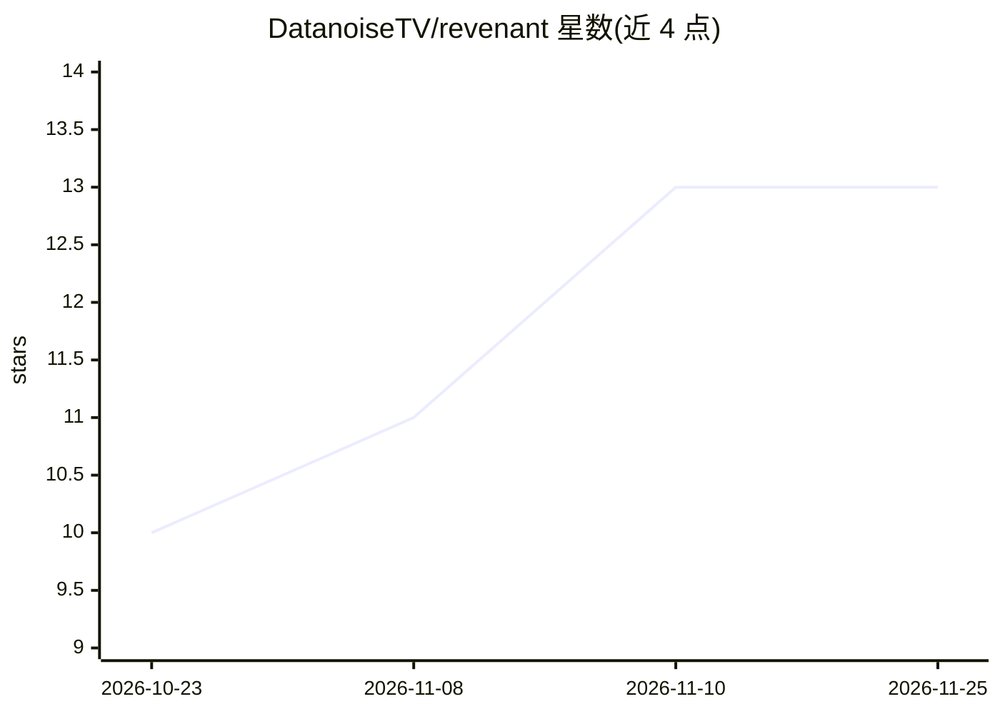

# DatanoiseTV/revenant

⭐ 13 · Python · Apache-2.0 · 推送 2026-07-05 · [GitHub](https://github.com/DatanoiseTV/revenant) · 个人维护

**面向被厂商弃维固件/二进制的 LLM 自动逆向工程引擎**

输入固件镜像或编译后的程序，输出可复活的工程产物：SoC 识别、外设清单、引脚映射、设备树源码、可编译的自定义固件工程、恢复的函数名，可选 1:1 开源重实现。管线为带缓存的并行 DAG，确定性阶段（分诊/提取/反汇编/设备树）不依赖 LLM，语义阶段走可插拔后端（默认 Claude Code 经 radare2 MCP 的 agentic 循环），默认开启对抗式交叉验证以标记弱结论。全部在 Docker 中运行，仅供合法授权的逆向场景。

## 筛选速览

| 维度 | 判定 | 备注 |
|---|---|---|
| AI 角色 | `ai-native` | 本体是模型或模型工具 |
| 许可风险 | `permissive` | Apache-2.0 |
| 部署形态 | `desktop` | 安装包/桌面程序 |
| 模型依赖 | locked-api |  |
| 硬件要求 | — | 无带数字的原话,不猜 |
| 安装摩擦 | `low` | 无编译、无系统依赖或容器化 |
| 成熟度 | — | 结构信号不足 |

## 能力要点

- 硬件轨：识别 SoC、重建引脚映射并生成可编译固件工程（ESP-IDF/Arduino/Zephyr 等）
- 软件轨：识别语言/运行时/框架并重建组件行为，支持 ELF/PE/Mach-O 与字节码
- 默认开启对抗式交叉验证，标记弱或幻觉结论
- 无 LLM 时确定性阶段仍产出架构、提取树与 MMIO 基址候选报告

## 适用场景

- 修复或保存厂商已停止支持的嵌入式设备
- 让自有设备之间实现互操作
- 对自己拥有或被授权测试的系统做安全研究
- 教学与计算历史存档的二进制分析

## 场景标签

`网络安全` · 领域:学习与行业

## 证据(README 行号)

> L8: **Resurrect abandoned hardware and software.** revenant is an LLM-powered,
> L159: The semantic stages (identification, pin map, behavior, naming, verification,
> L170: With no provider, the deterministic stages still produce a real report:

## 星数曲线

2026-10-23 10 → 2026-11-25 13（+3）

---
*卡片 v1 · prompt 1.4 · 生成 2026-11-18 · 置信度 high · 依据 README sha `048fbf862247` · [字段定义](../../DATASET.md)*
